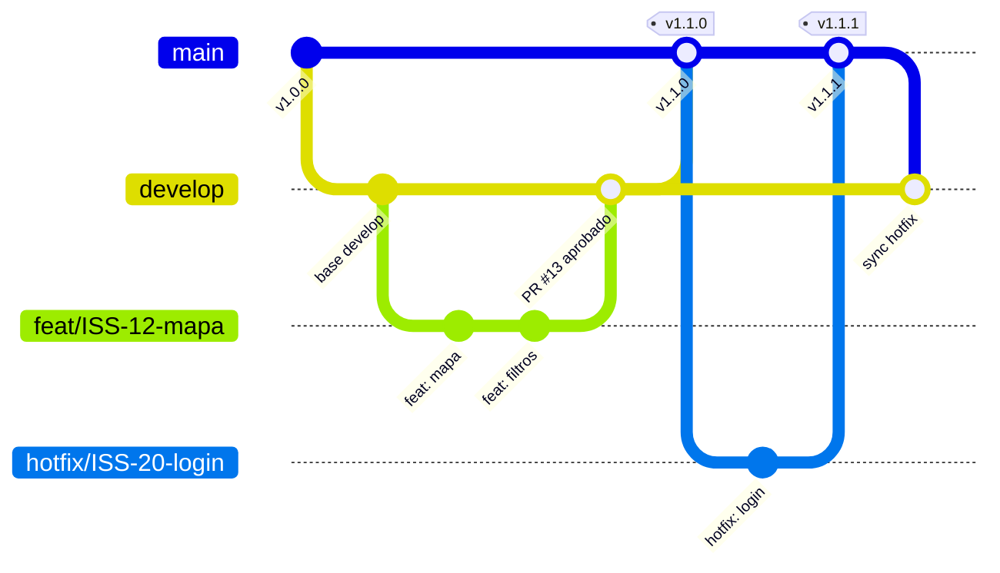
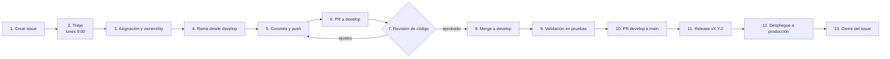

# Manual del Repositorio — Fábrica de Software procalculoFactory

> **Repositorio:** `procalculoFactory/Metodologia` · Reglas de la organización
> **Repositorio de Environments:** https://procalculo-my.sharepoint.com/my?id=%2Fpersonal%2Fjdiaz%5Fprocalculo%5Fcom%2FDocuments%2FEnvironments
> **Tablero de trabajo (GitHub Project):** https://github.com/orgs/procalculoFactory/projects/1
> **Última revisión:** octubre 2026 · **Responsable:** Líder Técnico (@procalculoFactoryLeader)

El presente manual constituye la referencia oficial de los procesos de la Fábrica de Software. Establece el procedimiento para la creación, revisión y despliegue de tareas, describe el funcionamiento de cada aplicación y documenta la resolución de las incidencias más frecuentes. Incluye, además, una guía dirigida a la gerencia y a los perfiles no técnicos que requieren supervisar el trabajo registrado en GitHub.

---

## Instructivo de lectura

| Perfil | Lectura principal | Lectura complementaria |
|---|---|---|
| **Gerencia / Product Owner** | [Parte A — Guía de GitHub para la gerencia](#parte-a--guía-de-github-para-la-gerencia) | [Parte B — Mapa de la organización](#parte-b--mapa-de-la-organización) |
| **Desarrollador de nuevo ingreso** | [Flujo de Trabajo Completo de Factory](#flujo-de-trabajo-completo-de-factory) y [Parte C — Ciclo de vida de una tarea](#parte-c--ciclo-de-vida-de-una-tarea-creación-revisión-y-despliegue) | [Parte D — Manual por aplicación](#parte-d--manual-por-aplicación) |
| **Líder técnico / revisor** | [C.4 Revisión de código](#c4-revisión-de-código-code-review) | [Parte E — Hallazgos y mejoras pendientes](#parte-e--hallazgos-y-mejoras-pendientes) |

## Tabla de contenido

- [Estructura del equipo](#estructura-del-equipo)
- [Flujo de Trabajo Completo de Factory](#flujo-de-trabajo-completo-de-factory)
  - [Roles y responsabilidades](#roles-y-responsabilidades)
  - [Estrategia de naming de repositorios](#estrategia-de-naming-de-repositorios)
  - [Estrategia de branching](#estrategia-de-branching)
  - [Estrategia de testing](#estrategia-de-testing)
- [Parte A — Guía de GitHub para la gerencia](#parte-a--guía-de-github-para-la-gerencia)
  - [A.1 Conceptos fundamentales](#a1-conceptos-fundamentales)
  - [A.2 Consulta del historial de cambios (commits)](#a2-consulta-del-historial-de-cambios-commits)
  - [A.3 Modelo de ramas](#a3-modelo-de-ramas)
  - [A.4 Lectura de un Pull Request](#a4-lectura-de-un-pull-request)
  - [A.5 Seguimiento del trabajo en el Project](#a5-seguimiento-del-trabajo-en-el-project)
  - [A.6 Identificación de la versión en producción](#a6-identificación-de-la-versión-en-producción)
  - [A.7 Rutina semanal de seguimiento](#a7-rutina-semanal-de-seguimiento)
  - [A.8 Glosario](#a8-glosario)
- [Parte B — Mapa de la organización](#parte-b--mapa-de-la-organización)
- [Parte C — Ciclo de vida de una tarea: creación, revisión y despliegue](#parte-c--ciclo-de-vida-de-una-tarea-creación-revisión-y-despliegue)
- [Parte D — Manual por aplicación](#parte-d--manual-por-aplicación)
- [Parte E — Hallazgos y mejoras pendientes](#parte-e--hallazgos-y-mejoras-pendientes)
- [Bibliografía y referencias](#bibliografía-y-referencias)

---

## Estructura del equipo

| Rol | Persona | Usuario GitHub | Responsabilidades |
|---|---|---|---|
| **Líder técnico** | Sebastián Díaz | @procalculoFactoryLeader | Backend senior, Desktop, ArcGIS, arquitectura, supervisión general, triaje |
| **Fullstack 1** | Andrés Carlos | @andres-c94 | Frontend, backend de soporte, supervisión de Brayan |
| **Fullstack 2** | Brian Bohórquez | @bbohorquezs | Backend, frontend de soporte |
| **Cloud / Infraestructura / Developer Jr** | Brayan Gerez | @bgerez | Cloud, scripts de AWS |

---

# Flujo de Trabajo Completo de Factory

Esta sección define los roles del equipo y los estándares técnicos de la Fábrica: nomenclatura de repositorios, modelo de ramas y estrategia de pruebas e integración continua. Estos estándares rigen el ciclo de vida de las tareas descrito en la [Parte C](#parte-c--ciclo-de-vida-de-una-tarea-creación-revisión-y-despliegue).

## Roles y responsabilidades

Los roles describen responsabilidades y no personas: un integrante puede ejercer más de un rol según el proyecto (ver [Estructura del equipo](#estructura-del-equipo)).

### Team Leader Fullstack
Responsable técnico de la fábrica y del resultado final en producción.

- Define la **arquitectura** de las soluciones (web, API, desktop/ArcGIS Pro, cloud).
- Lidera el **triaje semanal**: prioriza, estima y asigna issues al sprint o backlog.
- Es **reviewer obligatorio** de los PRs hacia `main` y de los cambios de arquitectura.
- Aprueba y coordina los **hotfix** y los despliegues a producción.
- Define y vela por los **estándares**: naming, branching, testing, seguridad y CI/CD.
- Desbloquea al equipo, resuelve dependencias entre proyectos (Cross-Project) y hace mentoría a los seniors y juniors.
- Puede desarrollar en cualquier capa (front, back, desktop) cuando el proyecto lo requiere.

### Frontend Senior
Responsable de la capa `-web` de las aplicaciones.

- Diseña la **arquitectura del frontend** (estructura de módulos/componentes, estado, routing, manejo de errores).
- Desarrolla las funcionalidades de UI y su integración con la API y servicios de mapas (ArcGIS Maps SDK).
- Garantiza **calidad visual y de experiencia**: responsive, accesibilidad, rendimiento de carga.
- Escribe y mantiene **pruebas unitarias** de componentes/servicios y **pruebas E2E** de los flujos críticos.
- Hace **code review** de los PRs de frontend y supervisa/acompaña a los juniors en tareas de front.
- Define junto al Backend Senior los **contratos de la API** que consume el front.

### Backend Senior
Responsable de la capa `-api` de las aplicaciones.

- Diseña la **arquitectura del backend**: modelos, ORM, endpoints REST, autenticación/autorización.
- Modela y optimiza la **base de datos** (PostgreSQL/PostGIS, SQL Server): migraciones, índices, queries espaciales.
- Integra servicios externos (ArcGIS Enterprise, proveedores de imágenes, servicios AWS).
- Garantiza **seguridad** (validación de inputs, manejo de credenciales, permisos) y **rendimiento**.
- Escribe y mantiene **pruebas unitarias** y **pruebas de integración** (API + BD).
- Documenta los endpoints (OpenAPI/Swagger) y hace **code review** de los PRs de backend.

### Junior Developer
Desarrollador en formación que trabaja bajo la supervisión de un senior.

- Toma **tareas acotadas** (template Jr Tasks): componentes, endpoints simples, scripts, ajustes de UI, corrección de bugs menores.
- Sigue estrictamente el **flujo de branching** y las **convenciones de naming** y de commits.
- Escribe **pruebas unitarias** para todo el código que entrega.
- Abre PRs pequeños y bien descritos; **atiende el feedback** del code review.
- Pregunta temprano: comenta en el issue cuando está bloqueado o con dudas, en lugar de esperar.
- Documenta lo que aprende (scripts, configuración, pasos de despliegue) para el resto del equipo.

---

## Estrategia de naming de repositorios

Cada aplicación se divide en repositorios por **capa**, con la nomenclatura:

```
<nombre-aplicacion>-<capa>
```

| Capa | Sufijo | Contenido | Ejemplo |
|------|--------|-----------|---------|
| Frontend | `-web` | Aplicación web (Angular / React / Next.js) | `abaco-web` |
| Backend | `-api` | API REST (Django REST Framework / FastAPI) | `abaco-api` |
| Desktop | `-desktop` | Add-in de ArcGIS Pro | `abaco-desktop` |

**Reglas:**
- Todo en **minúsculas**, palabras separadas por **guion** (`-`), sin espacios, tildes ni guion bajo.
- El nombre de la aplicación es el **mismo** en todas sus capas, para que los repos se agrupen al buscarlos.
- Si una aplicación necesita una capa adicional (ej. infraestructura o scripts), se sigue el mismo patrón: `<nombre-aplicacion>-infra`.
- Se exceptúan los repositorios de la organización que no son aplicaciones, como `Metodologia`.

> **Estado actual:** `mapasco-landing-web` y `prisma-agro-desktop` cumplen la convención. Los repositorios que no la cumplen se relacionan en [E.3](#e3-configuración-faltante-en-los-repositorios).

---

## Estrategia de branching

### Ramas permanentes

| Rama | Ambiente | Propósito |
|------|----------|-----------|
| `main` | **Producción** | Código en producción. Está conectada a **CI/CD**: todo push/merge a `main` se integra y despliega automáticamente (frontend en AWS hacia **CloudFront**; sitios estáticos mediante **GitHub Pages**). |
| `develop` (dev) | **Pruebas** | Integración y pruebas antes de pasar a producción. Toda modificación llega primero aquí. |

- **Nadie hace push directo a `main` ni a `develop`**: todo entra por Pull Request con review aprobado y checks en verde.
- `develop` → `main` se hace mediante PR cuando lo probado en dev está listo para producción.

### Ramas de trabajo (una por cada modificación)

Por cada nueva modificación se crea una rama desde `develop` con el formato:

```
<prefijo>/<cambio>
```

El **prefijo** indica el tipo de cambio y el **cambio** describe qué se hace, en minúsculas y con guiones. Opcionalmente se incluye el número del issue:

| Prefijo | Uso | Ejemplo |
|---------|-----|---------|
| `feat` | Nueva funcionalidad | `feat/add-orm` · `feat/ISS-123-add-orm` |
| `fix` | Corrección de un bug | `fix/b-component` · `fix/ISS-456-b-component` |
| `refactor` | Mejora interna sin cambiar comportamiento | `refactor/optimize-queries` |
| `docs` | Documentación | `docs/update-readme` |
| `test` | Agregar o corregir pruebas | `test/add-auth-tests` |
| `chore` | Configuración, dependencias, CI | `chore/update-dependencies` |
| `hotfix` | Corrección urgente en producción (sale de `main`) | `hotfix/ISS-789-login-error` |

Las tareas de los desarrolladores junior utilizan los mismos prefijos según el tipo de cambio. En la [Parte C](#c22-preparación-de-develop-y-creación-de-la-rama) se detalla el origen y el destino de cada tipo de rama.

> Git no permite `:` ni espacios en nombres de rama, por eso el `feat: add orm` del commit se escribe `feat/add-orm` en la rama. El mismo prefijo se usa en el mensaje del commit: `feat(api): add orm`.

### Flujo resumido

```
feat/add-orm ──PR──> develop (pruebas) ──PR──> main (producción ──CI/CD──> CloudFront)
                                                  ▲
hotfix/ISS-789-... ──────────────PR───────────────┘  (luego merge de main en develop)
```

---

## Estrategia de testing

### Pirámide de testing

```
            ▲
           /  \        Pocas   → Pruebas de usuario (E2E / UI)
          /----\
         /      \      Menos   → Pruebas de integración
        /--------\
       /          \    Muchas  → Pruebas unitarias
      /____________\
```

| Nivel | Cantidad | Qué prueba | Velocidad | Herramientas sugeridas |
|-------|----------|------------|-----------|------------------------|
| **Unitarias** | **Muchas** (la base) | Una función, clase, componente o servicio aislado, con dependencias simuladas (mocks) | Milisegundos | `pytest` / `unittest` (Django, FastAPI), Jest / Jasmine-Karma (React, Angular), MSTest / xUnit (add-in ArcGIS Pro) |
| **Integración** | **Menos** | Varias piezas trabajando juntas: endpoint + ORM + base de datos, servicio + API externa | Segundos | `pytest` + base de datos de pruebas (PostgreSQL/PostGIS en Docker), `TestClient` de FastAPI, `APITestCase` de DRF |
| **Usuario (E2E)** | **Pocas** (la punta) | Flujos críticos completos como los vive el usuario (login, crear/consultar un registro, ver el mapa) | Minutos | Playwright / Cypress |

**Reglas:**
- Todo PR que agregue lógica debe incluir **pruebas unitarias**.
- Los endpoints y consultas a base de datos importantes llevan **pruebas de integración**.
- Las pruebas E2E se reservan para los **flujos críticos** del negocio; no se duplican en E2E casos que ya cubren las unitarias.
- Un bug corregido debe venir con una prueba que **reproduzca el bug** y evite que regrese.

### Code Scanning con GitHub Actions

El análisis estático de seguridad se ejecuta automáticamente con **GitHub Actions** (CodeQL) en cada PR hacia `develop` y `main`, y de forma programada cada semana. Los hallazgos aparecen en la pestaña **Security → Code scanning** del repo, y un hallazgo de severidad alta bloquea el merge.

**`.github/workflows/codeql.yml`:**
```yaml
name: CodeQL

on:
  pull_request:
    branches: [develop, main]
  push:
    branches: [develop, main]
  schedule:
    - cron: "0 6 * * 1"   # lunes 6:00 UTC

jobs:
  analyze:
    runs-on: ubuntu-latest
    permissions:
      security-events: write
      contents: read
    strategy:
      matrix:
        language: [javascript-typescript, python]   # ajustar según el repo (csharp para -desktop)
    steps:
      - uses: actions/checkout@v4
      - uses: github/codeql-action/init@v3
        with:
          languages: ${{ matrix.language }}
      - uses: github/codeql-action/autobuild@v3
      - uses: github/codeql-action/analyze@v3
```

Complementos recomendados: **Dependabot** (alertas y actualización de dependencias vulnerables) y **Secret scanning** (detección de credenciales subidas por error).

### CI/CD con GitHub Actions

| Evento | CI (integración continua) | CD (despliegue continuo) |
|--------|---------------------------|--------------------------|
| PR hacia `develop` o `main` | Lint + pruebas unitarias + integración + build + CodeQL | — |
| Merge/push a `develop` | Lo mismo + E2E | Despliegue al ambiente de **pruebas** |
| Merge/push a `main` | Lo mismo | Despliegue a **producción** (frontend → S3 + **CloudFront**) |

**Ejemplo `.github/workflows/ci-cd.yml` (repo `-web`):**
```yaml
name: CI/CD

on:
  pull_request:
    branches: [develop, main]
  push:
    branches: [develop, main]

jobs:
  ci:
    runs-on: ubuntu-latest
    steps:
      - uses: actions/checkout@v4
      - uses: actions/setup-node@v4
        with:
          node-version: 20
          cache: npm
      - run: npm ci
      - run: npm run lint
      - run: npm test -- --watch=false
      - run: npm run build
      - uses: actions/upload-artifact@v4
        with:
          name: dist
          path: dist/

  deploy:
    needs: ci
    if: github.event_name == 'push' && github.ref == 'refs/heads/main'
    runs-on: ubuntu-latest
    environment: production
    permissions:
      id-token: write
      contents: read
    steps:
      - uses: actions/download-artifact@v4
        with:
          name: dist
          path: dist/
      - uses: aws-actions/configure-aws-credentials@v4
        with:
          role-to-assume: ${{ secrets.AWS_DEPLOY_ROLE_ARN }}
          aws-region: us-east-1
      - run: aws s3 sync dist/ s3://${{ secrets.S3_BUCKET }} --delete
      - run: aws cloudfront create-invalidation --distribution-id ${{ secrets.CLOUDFRONT_DISTRIBUTION_ID }} --paths "/*"
```

**Reglas:**
- Las **branch protection rules** de `main` y `develop` exigen que los jobs de CI y CodeQL pasen antes de permitir el merge.
- Las credenciales **nunca** van en el código: se usan **GitHub Secrets** y, en AWS, roles con OIDC.
- Los repos `-api` y `-desktop` siguen el mismo esquema de CI; su paso de despliegue cambia según el destino (ej. AWS para la API, empaquetado `.esriAddinX` como release para el add-in).

---

# Parte A — Guía de GitHub para la gerencia

> **Objetivo:** proporcionar a cualquier integrante de la organización, sin formación en programación, los elementos necesarios para determinar en GitHub el trabajo realizado en el periodo, sus responsables, las tareas pendientes y la versión vigente en producción.

## A.1 Conceptos fundamentales

GitHub es la plataforma donde se almacena y controla el código fuente de las aplicaciones de la organización. Su funcionamiento es equiparable al de un gestor documental con control de versiones.

| Concepto | Equivalente funcional | Descripción |
|---|---|---|
| **Git** | Control de cambios de un procesador de texto, aplicado a un proyecto completo | Herramienta que registra cada modificación del código. GitHub es la plataforma web que aloja dicho registro ([GitHub Docs](https://docs.github.com/es/get-started/start-your-journey/about-github-and-git)). |
| **Organización** | La empresa dentro de GitHub | `procalculoFactory` agrupa los proyectos y los integrantes de la Fábrica. |
| **Repositorio** | Carpeta de proyecto con su historial completo | Cada aplicación cuenta con su propio repositorio, por ejemplo `mapasco-landing-web` o `prisma-agro-desktop` ([GitHub Docs](https://docs.github.com/es/repositories/creating-and-managing-repositories/about-repositories)). |
| **Commit** | Versión guardada del proyecto, con nota explicativa | Cada avance registrado deja constancia del autor, la fecha y el cambio realizado. |
| **Rama (branch)** | Copia de trabajo paralela | Permite desarrollar sin afectar la versión estable. Una vez aprobada, se integra a la versión principal ([GitHub Docs](https://docs.github.com/es/pull-requests/collaborating-with-pull-requests/proposing-changes-to-your-work-with-pull-requests/about-branches)). |
| **Issue** | Ticket o requerimiento | Registro de una solicitud, error o mejora, con responsable, prioridad y fechas ([GitHub Docs](https://docs.github.com/es/issues/tracking-your-work-with-issues/about-issues)). |
| **Pull Request (PR)** | Solicitud formal de aprobación | El desarrollador solicita la revisión de su trabajo antes de integrarlo a la versión principal ([GitHub Docs](https://docs.github.com/es/pull-requests/collaborating-with-pull-requests/proposing-changes-to-your-work-with-pull-requests/about-pull-requests)). |
| **Merge** | Aprobación e incorporación | Integración de los cambios aprobados en la rama destino. |
| **Project** | Tablero de gestión (Kanban) | Presenta las tareas por estado: pendiente, en curso, en revisión y finalizada ([GitHub Docs](https://docs.github.com/es/issues/planning-and-tracking-with-projects/learning-about-projects/about-projects)). |
| **GitHub Actions** | Automatización de procesos | Ejecuta pruebas y despliegues de forma automática ante cada cambio ([GitHub Docs](https://docs.github.com/es/actions/about-github-actions/understanding-github-actions)). |
| **GitHub Pages** | Servicio de publicación web | Publica sitios estáticos directamente desde un repositorio; lo utilizan varias páginas de la organización ([GitHub Docs](https://docs.github.com/es/pages/getting-started-with-github-pages/what-is-github-pages)). |
| **Release / Tag** | Versión oficial numerada | Identifica la versión exacta entregada, por ejemplo `v1.2.0` ([GitHub Docs](https://docs.github.com/es/repositories/releasing-projects-on-github/about-releases)). |

## A.2 Consulta del historial de cambios (commits)

**Procedimiento (no requiere instalación):**

1. Ingresar a https://github.com/procalculoFactory y seleccionar el repositorio.
2. Hacer clic en el indicador **"Commits"**, ubicado sobre la lista de archivos.
3. Se presenta la lista de commits en orden cronológico descendente. Cada registro contiene:
   - **Mensaje:** descripción del cambio (ej. `feat(ui): agregar sección de industrias`).
   - **Autor** y **fecha**.
   - **Identificador** corto (ej. `a1b2c3d`), único para cada cambio.
4. Al seleccionar un commit se visualiza el detalle de la modificación: las líneas en verde corresponden a adiciones y las líneas en rojo a eliminaciones.
5. Para consultar otra rama, utilizar el selector de ramas ubicado en la parte superior izquierda.

**Interpretación del mensaje.** La organización adopta la convención [Conventional Commits](https://www.conventionalcommits.org/es/v1.0.0/):

| Prefijo | Significado |
|---|---|
| `feat(...)` | Nueva funcionalidad |
| `fix(...)` | Corrección de un error |
| `hotfix(...)` | Corrección urgente en producción |
| `docs(...)` | Cambio exclusivo de documentación |
| `refactor(...)` | Mejora interna del código sin cambio funcional visible |
| `chore(...)` | Mantenimiento (configuración, dependencias) |

> **Indicador de control:** los commits con mensajes genéricos como *"Add files via upload"* o *"update"* evidencian una carga manual de archivos desde el navegador, por fuera del flujo de ramas y revisión. Se recomienda solicitar la justificación correspondiente.

Referencia: [Ver y comparar commits — GitHub Docs](https://docs.github.com/es/pull-requests/committing-changes-to-your-project/viewing-and-comparing-commits/differences-between-commit-views)

## A.3 Modelo de ramas

La organización adopta el modelo **GitFlow** (detalle técnico en [Estrategia de branching](#estrategia-de-branching)) ([Driessen, 2010](https://nvie.com/posts/a-successful-git-branching-model/); [Atlassian](https://www.atlassian.com/es/git/tutorials/comparing-workflows/gitflow-workflow)), estructurado de la siguiente manera:

| Rama | Función | Regla |
|---|---|---|
| `main` | Versión en producción | Contiene únicamente lo desplegado en producción. No se desarrolla directamente sobre ella. |
| `develop` | Integración | Consolida las funcionalidades terminadas antes de su paso a producción. |
| `feat/...` | Desarrollo de nuevas funcionalidades | Se crea desde `develop` y se integra en `develop`. |
| `fix/...` | Corrección de errores | Se crea desde `develop` y se integra en `develop`. |
| `refactor/`, `docs/`, `test/`, `chore/` | Mejoras internas, documentación, pruebas y mantenimiento | Se crean desde `develop` y se integran en `develop`. |
| `hotfix/ISS-...` | Atención de incidentes en producción | Se crea desde `main` y se integra en `main` y en `develop`. |



**Consulta de ramas:** dentro del repositorio, abrir el selector de ramas y seleccionar **"View all branches"**. Se presentan las ramas activas, las desactualizadas y las que tienen un Pull Request asociado.

## A.4 Lectura de un Pull Request

1. Abrir la pestaña **"Pull requests"** del repositorio.
2. Cada PR presenta uno de los siguientes estados: **Open** (en revisión), **Merged** (aprobado e integrado) o **Closed** (descartado).
3. Secciones del PR:
   - **Conversation:** descripción, issue vinculado (`Fixes #123`) y observaciones de los revisores.
   - **Commits:** secuencia de cambios del desarrollador.
   - **Checks:** resultado de las pruebas automáticas (aprobadas o fallidas).
   - **Files changed:** archivos modificados.
4. Un PR se considera listo para integración cuando cuenta con al menos una aprobación (*Approved*), las verificaciones automáticas en estado exitoso y un issue vinculado.

Referencia: [Acerca de las revisiones de PR — GitHub Docs](https://docs.github.com/es/pull-requests/collaborating-with-pull-requests/reviewing-changes-in-pull-requests/about-pull-request-reviews)

## A.5 Seguimiento del trabajo en el Project

El tablero https://github.com/orgs/procalculoFactory/projects/1 consolida los issues de todos los repositorios. Cada tarea registra los siguientes campos:

| Campo | Valores en uso | Finalidad |
|---|---|---|
| **Type** | `Feature`, `Task`, `Bug` | Clasificación de la tarea |
| **Priority** | `Urgent`, `High`, `Medium`, `Low` | Orden de atención |
| **Effort** | `High`, `Medium`, `Low` | Estimación del esfuerzo |
| **Start date / Target date** | Fechas | Planificación de la entrega |
| **Assignees** | Responsable | Rendición de cuentas |

**Vistas recomendadas para la gerencia:**
- **Board:** columnas por estado. Las tareas con permanencia prolongada en *In Progress* requieren seguimiento.
- **Table:** filtros por responsable (`assignee:usuario`) o prioridad (`priority:Urgent`).
- **Roadmap:** línea de tiempo basada en *Start date* y *Target date*, útil para identificar retrasos.

## A.6 Identificación de la versión en producción

- **Principio general:** el contenido de la rama `main` corresponde a la versión en producción.
- La pestaña **"Releases"** lista las versiones oficiales con numeración [SemVer](https://semver.org/lang/es/) `MAYOR.MENOR.PARCHE`. La versión `2.3.1`, por ejemplo, corresponde a la versión mayor 2, con tres entregas de funcionalidad y una corrección.
- La pestaña **"Actions"** informa el resultado del último despliegue automatizado.
- En los sitios publicados con GitHub Pages, la sección **"Deployments"** (columna derecha del repositorio) indica la fecha del último despliegue.

## A.7 Rutina semanal de seguimiento

| Periodicidad | Control | Ubicación |
|---|---|---|
| **Lunes 9:00** | Triaje: issues nuevos con prioridad y responsable asignados | Project, vista Table, filtro `no:assignee` |
| **Miércoles** | Tareas con más de cinco días en *In Progress* | Project, vista Board |
| **Viernes** | Entregas de la semana: PRs integrados | `https://github.com/pulls?q=org:procalculoFactory+is:merged+merged:>AAAA-MM-DD` |
| **Cada entrega** | Existencia de un Release con notas de versión | Pestaña Releases de cada repositorio |

## A.8 Glosario

| Término | Definición |
|---|---|
| **Clone** | Descarga de una copia del repositorio a un equipo local |
| **Push** | Envío de commits locales a GitHub |
| **Pull** | Actualización del equipo local con los cambios de GitHub |
| **Conflicto** | Modificación simultánea de las mismas líneas por dos personas; requiere una decisión manual ([GitHub Docs](https://docs.github.com/es/pull-requests/collaborating-with-pull-requests/addressing-merge-conflicts/about-merge-conflicts)) |
| **Branch protection** | Regla que impide integrar cambios en `main` sin revisión ([GitHub Docs](https://docs.github.com/es/repositories/configuring-branches-and-merges-in-your-repository/managing-protected-branches/about-protected-branches)) |
| **CI/CD** | Integración y despliegue continuos: pruebas y despliegues automatizados |
| **Secret** | Contraseña o llave de API; no debe almacenarse en el código |
| **Label** | Etiqueta de clasificación de un issue o PR (`bug`, `enhancement`, etc.) |
| **Milestone** | Agrupación de issues correspondiente a una entrega o sprint |

---

# Parte B — Mapa de la organización

## B.1 Repositorios

| Repositorio | Descripción | Tecnología | Visibilidad | Despliegue | Responsable principal |
|---|---|---|---|---|---|
| [`Metodologia`](https://github.com/procalculoFactory/Metodologia) | Manual y reglas de la Fábrica | Markdown | Pública | GitHub Pages | @procalculoFactoryLeader |
| [`mapasco-landing-web`](https://github.com/procalculoFactory/mapasco-landing-web) | Landing page de Mapas CO | HTML, CSS, JS | Pública | GitHub Pages | @andres-c94 |
| [`landing-page-web-v2-mockup`](https://github.com/procalculoFactory/landing-page-web-v2-mockup) | Prototipo multipágina del nuevo sitio corporativo (soluciones, industrias, ArcGIS, soporte) | HTML, CSS, JS | Pública | GitHub Pages | @andres-c94 |
| [`team-progress`](https://github.com/procalculoFactory/team-progress) | Tablero de resultados de la Fábrica ("FABRICA 2025") | HTML | Pública | GitHub Pages | @procalculoFactoryLeader |
| [`prisma-agro-desktop`](https://github.com/procalculoFactory/prisma-agro-desktop) | Add-in de ArcGIS Pro para Prisma Agro (mosaico multidimensional NGRDI) | C#, .NET 8, WPF, ArcGIS Pro SDK | Pública | Archivo `.esriAddinX` | @bbohorquezs / @procalculoFactoryLeader |
| [`sh-ott`](https://github.com/procalculoFactory/sh-ott) | Herramientas Python de Sentinel Hub: áreas quemadas, deforestación y descarga de polígonos por índice | Python, sentinelhub-py, GeoPandas | Pública (ver E.2) | Ejecución local | Por definir |
| **ABACO** *(repositorio privado)* | Sistema de monitoreo de deforestación en producción | AWS | Privada | AWS (CloudFront) | @procalculoFactoryLeader |
| **Prisma API** *(repositorio privado)* | API de análisis de imágenes satelitales en producción | AWS | Privada | AWS | @procalculoFactoryLeader |
| **Mapas.co** *(repositorio privado)* | Plataforma web geoespacial | AWS | Privada | AWS | @procalculoFactoryLeader |

> **Nota:** la información de los repositorios privados se completará una vez verificado su contenido. Ver [E.1](#e1-información-pendiente).

## B.2 Asignación automática por tipo de tarea (estado objetivo)

```
Frontend Issues      -> @andres-c94
Backend Issues       -> @procalculoFactoryLeader
Desktop/ArcGIS       -> @procalculoFactoryLeader
Backend Fullstack    -> @andres-c94
Jr Frontend Tasks    -> @bgerez
Jr Backend Tasks     -> @bbohorquezs
Technical Review     -> @procalculoFactoryLeader
Cross-Project        -> @procalculoFactoryLeader
```

> **Estado actual:** ningún repositorio público dispone de la carpeta `.github/` con plantillas de issues; en consecuencia, la asignación automática no se encuentra activa. Ver [E.3](#e3-configuración-faltante-en-los-repositorios).

---

# Parte C — Ciclo de vida de una tarea: creación, revisión y despliegue



## C.1 Creación

**Partes autorizadas para crear issues:** clientes y usuarios (errores y solicitudes), Product Owner o gerencia, integrantes del equipo y QA.

**Procedimiento:**
1. Ingresar al **repositorio de la aplicación afectada** (no al Project) y seleccionar **Issues > New issue**.
2. Seleccionar el tipo: **Bug**, **Feature** o **Task**.
3. Redactar un **título breve y accionable**. Ejemplo adecuado: *"Error 500 al exportar polígonos en Mapas.co"*. Ejemplo inadecuado: *"no sirve"*.
4. Diligenciar la descripción con la plantilla correspondiente:

**Plantilla: Bug**
```markdown
## Comportamiento observado
## Comportamiento esperado
## Pasos para reproducir
1. ...
## Ambiente (producción / pruebas, navegador, versión)
## Evidencia (capturas, logs, URL)
```

**Plantilla: Feature / Task**
```markdown
## Objetivo
## Alcance
## Fuera de alcance
## Criterios de aceptación
- [ ] ...
## Entregables
## Referencias (diseños, documentos, SharePoint)
```

> **Referencia de buena práctica:** el issue `Metodologia#6 — PIP MVP` incluye objetivo, alcance, exclusiones, criterios de aceptación y entregables, y se adopta como modelo de redacción.

5. Asociar el issue al **Project #1** (panel derecho, sección *Projects*) y diligenciar **Priority**, **Effort** y fechas.

### C.1.1 Triaje semanal (lunes 9:00 a. m.), a cargo del líder técnico

1. Revisar los issues nuevos sin prioridad o con la etiqueta `needs-triage`.
2. **Asignar prioridad:**
   - **Urgent:** bloquea producción o usuarios.
   - **High:** afecta una funcionalidad relevante.
   - **Medium:** mejora significativa.
   - **Low:** mejora deseable.
3. **Estimar esfuerzo:**
   - **Low:** 1 a 2 días.
   - **Medium:** 3 a 5 días.
   - **High:** 1 semana o más.
   - **Épica:** debe dividirse en sub-issues.
4. Designar responsable y asignar al sprint vigente o al backlog.

## C.2 Desarrollo

### C.2.1 Asunción de la tarea
El responsable registra en el issue el siguiente comentario:
```
Tomando ownership de este issue
ETA: [fecha]
Preguntas: [si aplica]
```
A continuación, traslada la tarjeta a **In Progress** en el Project.

### C.2.2 Preparación de `develop` y creación de la rama

> **Regla:** las funcionalidades y correcciones no se crean desde `main`. Solo los hotfix se originan en `main`.

```bash
git fetch origin
git checkout develop
git pull origin develop
git merge origin/main        # garantiza que develop incluya los hotfix aplicados
git push origin develop

git checkout -b feat/ISS-123-descripcion-corta
git push -u origin feat/ISS-123-descripcion-corta
```

**Convención de nombres de ramas** (formato `<prefijo>/<cambio>`, ver [Estrategia de branching](#estrategia-de-branching)):

| Tipo | Patrón | Origen | Destino |
|---|---|---|---|
| Funcionalidad | `feat/ISS-{n}-{descripcion}` | `develop` | `develop` |
| Corrección | `fix/ISS-{n}-{descripcion}` | `develop` | `develop` |
| Refactorización | `refactor/ISS-{n}-{descripcion}` | `develop` | `develop` |
| Documentación, pruebas, mantenimiento | `docs/`, `test/`, `chore/` | `develop` | `develop` |
| Urgencia | `hotfix/ISS-{n}-{descripcion}` | `main` | `main` y `develop` |

`{n}` corresponde al **número del issue en GitHub**; puede omitirse en cambios menores sin issue (ej. `fix/b-component`). Las ramas creadas antes de esta convención, como `feature/ISS-1-ngrdi-refactoring` en `prisma-agro-desktop`, conservan su nombre hasta su integración.

### C.2.3 Commits

```bash
git add <archivos>      # verificar previamente con "git status"
git commit -m "feat(ui): agregar sección de industrias

- Maquetar bloque de tarjetas
- Ajustar estilos responsive

Related to #6"
git push
```

| Tipo | Formato | Vínculo con el issue |
|---|---|---|
| Feature | `feat(scope): descripción` | `Related to #n` |
| Bugfix | `fix(scope): descripción` | `Fixes #n` (cierra el issue al integrar) |
| Hotfix | `hotfix(scope): descripción` | `Fixes #n` |

**Scopes de uso común:** `auth`, `ui`, `api`, `db`, `security`, `performance`, `gis`, `infra`, `docs`.

**Verificaciones previas a cada commit:**
- Con `git status`, confirmar que no se incluyen archivos `.env`, credenciales, `__pycache__/`, `bin/`, `obj/`, `node_modules/` ni resultados pesados (`.tif`, `.shp`).
- Confirmar que el `.gitignore` del repositorio contempla dichos casos.

## C.3 Apertura del Pull Request

1. Seleccionar **"Compare & pull request"** en GitHub. En su defecto, ir a *Pull requests > New* con **base:** `develop` y **compare:** `feat/ISS-...`.
2. **Título:** `feat(ui): Sección de industrias - ISS-6`
3. **Descripción** (plantilla `.github/pull_request_template.md`):

```markdown
## Descripción
## Issue relacionado
Fixes #___ / Related to #___
## Tipo de cambio
- [ ] Bug fix   - [ ] Feature   - [ ] Breaking change   - [ ] Docs
## Cambios realizados
## Procedimiento de prueba
## Evidencia (capturas / video)
## Lista de verificación
- [ ] Autorrevisión realizada
- [ ] Sin secretos ni archivos generados en el diff
- [ ] Pruebas unitarias incluidas (ver [Estrategia de testing](#estrategia-de-testing))
- [ ] Verificaciones de CI y CodeQL en estado exitoso
- [ ] Documentación actualizada (README de la aplicación)
```

4. Configurar **Reviewers** (según la matriz de C.4), **Assignee**, **Labels** y **Project**.
5. Utilizar **Draft PR** cuando el trabajo no esté terminado.
6. Notificar en Teams: *"PR listo para revisión: [enlace]"*.

Referencia: [Vincular un PR a un issue — GitHub Docs](https://docs.github.com/es/issues/tracking-your-work-with-issues/using-issues/linking-a-pull-request-to-an-issue)

## C.4 Revisión de código (Code Review)

**Matriz de revisión**

| Autor del PR | Revisor obligatorio | Revisor opcional |
|---|---|---|
| @bgerez (Jr) | @andres-c94 | @procalculoFactoryLeader |
| @bbohorquezs | @procalculoFactoryLeader | @andres-c94 |
| @andres-c94 | @procalculoFactoryLeader | @bbohorquezs |
| @procalculoFactoryLeader | @andres-c94 o @bbohorquezs | — |
| Hotfix (cualquier autor) | @procalculoFactoryLeader | — |

**Lista de verificación del revisor**

| Área | Criterio |
|---|---|
| Lógica | Cumple lo solicitado en el issue y sus criterios de aceptación |
| Calidad | Estilo consistente, nomenclatura clara, sin código obsoleto |
| Pruebas | Pruebas unitarias incluidas y aprobadas en CI; cobertura de casos límite (ver [Estrategia de testing](#estrategia-de-testing)) |
| Seguridad | Ausencia de credenciales en el código, validación de entradas, sin archivos `.env` en el diff |
| Rendimiento | Consultas y llamadas a APIs externas (Planet, Sentinel Hub, ArcGIS) con límites y paginación |
| GIS | CRS explícito, geometrías válidas, tratamiento de multipolígonos |
| Documentación | README de la aplicación actualizado cuando cambie la ejecución o el despliegue |

**Respuesta del revisor:** utilizar *Request changes* ante observaciones bloqueantes y *Comment* para sugerencias. La aprobación procede una vez resueltas todas las observaciones. El autor atiende cada comentario, actualiza la misma rama y solicita nueva revisión mediante **Re-request review**.

**Situaciones frecuentes:**

```bash
# Conflictos con develop
git checkout feat/ISS-123-x
git fetch origin && git merge origin/develop
# resolver los archivos señalados y continuar:
git add <archivos> && git commit -m "chore: resolver conflictos con develop"
git push

# Rama desactualizada (solo si la rama no es compartida)
git rebase origin/develop
git push --force-with-lease
```

Los PR de gran tamaño deben dividirse en entregas incrementales.

**Funcionalidades de apoyo en GitHub:**
- **Draft PR:** para trabajo en curso; los revisores se asignan cuando se marca como *Ready for review*.
- **Auto-merge:** integra el PR automáticamente cuando reúne las aprobaciones y verificaciones; solo para PR no críticos.
- **GitHub CLI (opcional):**
  ```bash
  gh pr create --base develop --title "feat(auth): validar login - ISS-123" --body "Related to #123"
  gh pr status
  ```

## C.5 Despliegue

### C.5.1 Flujo regular (release)

1. Integrar las funcionalidades aprobadas en `develop` y validarlas en el **ambiente de pruebas** de la aplicación (ver [Parte D](#parte-d--manual-por-aplicación)).
2. Abrir un PR de **`develop` hacia `main`** con el título `release: vX.Y.Z` y la relación de issues incluidos.
3. Tras la integración, crear el **tag y el Release**:
   ```bash
   git checkout main && git pull
   git tag -a v1.4.0 -m "Release 1.4.0"
   git push origin v1.4.0
   ```
   En GitHub, seleccionar **Releases > Draft a new release**, elegir el tag y utilizar **Generate release notes**.
4. Verificar el despliegue: la integración en `main` dispara el pipeline de CI/CD (ver [CI/CD con GitHub Actions](#cicd-con-github-actions)). Las aplicaciones sin pipeline siguen el procedimiento descrito en la [Parte D](#parte-d--manual-por-aplicación).
5. Realizar la verificación posterior al despliegue (*smoke test*) y cerrar los issues incluidos.

### C.5.2 Versionamiento (SemVer)

Acordado en `Metodologia#2` con base en [SemVer](https://semver.org/lang/es/):

| Componente | Criterio | Ejemplo |
|---|---|---|
| **MAYOR** | Cambio incompatible o rediseño | `1.4.2 -> 2.0.0` |
| **MENOR** | Nueva funcionalidad compatible | `1.4.2 -> 1.5.0` |
| **PARCHE** | Corrección de errores o hotfix | `1.4.2 -> 1.4.3` |

### C.5.3 Hotfix (incidente en producción)

```bash
git checkout main && git pull origin main
git checkout -b hotfix/ISS-789-descripcion
# corrección mínima y focalizada
git commit -m "hotfix(security): corregir validación de entrada

URGENT: Fixes #789"
git push -u origin hotfix/ISS-789-descripcion
```

1. Abrir un PR hacia **`main`** con el título `HOTFIX(scope): descripción - ISS-789`.
2. Asignar las etiquetas `hotfix` y `critical`. El revisor es el líder técnico, con un tiempo máximo de revisión de 30 minutos.
3. La descripción debe incluir el problema, la solución, las pruebas, el impacto (sistemas y usuarios) y el **plan de reversión**:
   ```markdown
   ## HOTFIX CRÍTICO
   ### Problema
   ### Issue relacionado
   Fixes #___ (CRITICAL)
   ### Solución implementada
   ### Pruebas de emergencia
   - [ ] Pruebas de la corrección aprobadas
   - [ ] Flujo crítico verificado, sin regresiones
   ### Impacto
   - Sistemas afectados:
   - Usuarios impactados:
   - Tiempo de indisponibilidad esperado:
   ### Plan de reversión
   ```
4. Integrar (el pipeline despliega a producción), crear el tag de **PARCHE** (`v1.4.3`) y aplicar monitoreo reforzado.
5. **Sincronizar `develop` de forma obligatoria:**
   ```bash
   git checkout develop && git pull
   git merge main
   git push origin develop
   ```

### C.5.4 Reglas de cumplimiento obligatorio

- Las funcionalidades y correcciones se integran en `develop`; los hotfix se integran en `main` y se sincronizan con `develop`.
- Todo PR debe estar vinculado a un issue (`Fixes #` / `Related to #`).
- No se permite el envío directo de cambios a `main` ni a `develop`.
- **Ningún secreto debe almacenarse en el repositorio.** Las credenciales se gestionan en GitHub Secrets, AWS Secrets Manager o el [Repositorio de Environments](https://procalculo-my.sharepoint.com/my?id=%2Fpersonal%2Fjdiaz%5Fprocalculo%5Fcom%2FDocuments%2FEnvironments).
- No se admite la carga manual de archivos ("Add files via upload") en repositorios de aplicaciones; todo cambio se tramita mediante rama y PR.

---

# Parte D — Manual por aplicación

Cada aplicación se rige por el ciclo descrito en la Parte C. Esta sección documenta los aspectos específicos de cada una: funcionalidad, ejecución, despliegue y resolución de incidencias frecuentes.

---

## D.1 `mapasco-landing-web` — Landing page de Mapas CO

**Descripción:** sitio estático de presentación comercial de Mapas CO. Archivos principales: `index.html`, `styles.css`, `main.js` y la carpeta `public/` (imágenes y recursos).

**URL publicada:** https://procalculofactory.github.io/mapasco-landing-web/

**Ejecución local:**
```bash
git clone https://github.com/procalculoFactory/mapasco-landing-web.git
cd mapasco-landing-web
python -m http.server 8080      # alternativa: npx serve .
# abrir http://localhost:8080
```

**Creación de tareas:** un issue por sección del sitio (patrón vigente: `Home-Section`, `solutions-section`, `industries-section`, `about-us-section`, `sac-sectione`). Cada issue debe incluir el enlace al insumo de mercadeo (SharePoint), los **criterios de aceptación** y las **capturas del diseño**. Actualmente los issues #4 a #8 contienen únicamente el enlace.

**Revisión:** validar en escritorio y dispositivos móviles (DevTools, modo responsive) y contrastar enlaces y textos con lo aprobado por mercadeo. Adjuntar capturas al PR.

**Despliegue:** GitHub Pages publica automáticamente la rama configurada en *Settings > Pages*. El archivo `.nojekyll` impide el procesamiento con Jekyll. Flujo: PR a `develop`, validación, PR de `develop` a `main` y publicación automática.

> **Observación:** el repositorio cuenta únicamente con la rama `main`. Se requiere crear `develop` antes de la siguiente tarea para dar cumplimiento a GitFlow.

**Incidencias frecuentes:**

| Síntoma | Causa probable | Solución |
|---|---|---|
| Los cambios no se reflejan tras la integración | Caché del navegador o de la CDN de Pages | Recarga forzada (Ctrl+Shift+R); revisar *Actions > pages-build-deployment* |
| Imágenes no visibles en Pages pero sí en local | Rutas absolutas (`/public/img.png`) en un sitio servido bajo `/mapasco-landing-web/` | Utilizar rutas relativas (`public/img.png`) |
| Archivos o carpetas con prefijo `_` devuelven 404 | Exclusión por parte de Jekyll | Conservar `.nojekyll` en la raíz |
| Error 404 en todo el sitio | Pages desactivado o rama mal configurada | *Settings > Pages*, origen: rama `main` / root |
| Falla del dominio propio | Ausencia del archivo `CNAME` o cambio en el DNS | Restaurar `CNAME`; verificar el registro DNS hacia `procalculofactory.github.io` |

---

## D.2 `landing-page-web-v2-mockup` — Prototipo del sitio corporativo v2

**Descripción:** prototipo navegable multipágina (`index.html`, `soluciones.html`, `soluciones-arcgis.html`, `industrias.html`, `quienes-somos.html`, `soporte.html`, `tratamiento-datos.html`) con `styles.css` y `script.js` compartidos.

**URL publicada:** https://procalculofactory.github.io/landing-page-web-v2-mockup/

**Ejecución, revisión y despliegue:** conforme a [D.1](#d1-mapasco-landing-web--landing-page-de-mapas-co). Por tratarse de un prototipo, los PR requieren, además de la aprobación técnica, la aprobación del área de negocio o mercadeo.

**Incidencias frecuentes:**

| Síntoma | Solución |
|---|---|
| El menú no navega entre páginas en Pages | Utilizar enlaces relativos (`soluciones.html`) en lugar de `/soluciones.html` |
| Estilos inconsistentes entre páginas | Importar el mismo `styles.css` en todas las páginas; evitar estilos en línea duplicados |
| `styles.css` de gran tamaño (~75 KB) y difícil mantenimiento | Segmentar por secciones o componentes al pasar a desarrollo productivo |
| Formularios de contacto sin envío | El prototipo no tiene backend; documentarlo en el issue o integrar un servicio de formularios en la versión productiva |

---

## D.3 `team-progress` — Tablero de resultados de la Fábrica

**Descripción:** tablero de una sola página (`index.html`) con los resultados del equipo ("FABRICA 2025"): métricas, puntajes de errores y elementos de gamificación.

**URL publicada:** https://procalculofactory.github.io/team-progress/

**Creación de tareas:** todo cambio en métricas o umbrales (por ejemplo, el puntaje de errores) debe contar con un issue que documente el **criterio de cálculo** acordado.

**Despliegue:** GitHub Pages desde `main`.

**Incidencias frecuentes:**

| Síntoma | Solución |
|---|---|
| Los datos no se actualizan | Los datos están embebidos en el HTML; se deben editar y desplegar. Se recomienda trasladarlos a un archivo `data.json` independiente |
| Errores de tildes o caracteres (ej. "ALINEACÓN") | Guardar el archivo en UTF-8 y verificar `<meta charset="utf-8">` |
| Exposición pública del rendimiento del equipo | Evaluar el cambio a repositorio privado (Pages en repositorios privados requiere plan de pago) |

---

## D.4 `prisma-agro-desktop` — Add-in de ArcGIS Pro (Prisma Agro)

**Descripción:** add-in para **ArcGIS Pro 3.5** desarrollado en C# (.NET 8, WPF) con el ArcGIS Pro SDK. Su desarrollo principal corresponde a la refactorización, bajo principios SOLID, de la herramienta de **mosaico multidimensional NGRDI** (issue #1). El README del repositorio contiene la **homologación arcpy / ArcGIS API for Python**, referencia para la migración de la lógica a servicios web.

**Estructura:** `Config.daml` (registro del add-in), `Module1.cs` (módulo principal), `Images/` y `DarkImages/` (íconos), `prisma-agro-desktop.csproj` y `.sln`.

**Ramas:** `main`, `develop` y `feature/ISS-1-ngrdi-refactoring`. Es el repositorio con mayor adherencia a GitFlow.

**Requisitos de compilación:**
- Windows con **ArcGIS Pro 3.5** instalado en `C:\Program Files\ArcGIS\Pro`.
- Visual Studio 2022 con la extensión **ArcGIS Pro SDK for .NET** y el SDK de .NET 8.

**Ejecución y depuración:** abrir el `.sln` en Visual Studio y ejecutar con F5. ArcGIS Pro inicia con el add-in cargado en la pestaña **Add-In**.

**Despliegue:** compilar en modo *Release* para generar `prisma-agro-desktop.esriAddinX` y publicarlo como **asset del Release** en GitHub (`vX.Y.Z`). La instalación se realiza mediante doble clic o desde *ArcGIS Pro > Settings > Add-In Manager*.

**Incidencias frecuentes:**

| Síntoma | Causa probable | Solución |
|---|---|---|
| Errores de referencia `ArcGIS.Desktop.*` al compilar | ArcGIS Pro instalado fuera de la ruta por defecto | Instalar en `C:\Program Files\ArcGIS\Pro` o ajustar las `HintPath` del `.csproj` |
| El add-in no aparece en ArcGIS Pro | Versión de Pro inferior a `desktopVersion` (3.5) definida en `Config.daml` | Actualizar ArcGIS Pro o reducir `desktopVersion` si el código lo permite |
| El add-in carga sin botones | El grupo `Group 1` de `Config.daml` no tiene controles registrados | Registrar los controles en `<controls>` y referenciarlos en el grupo |
| Autor mostrado como "Acme" / "macbookproretina" | Metadatos de plantilla en `Config.daml` | Actualizar `<Company>` a Procalculo S.A.S. y `<Author>` al equipo |
| Fallas en herramientas de imagen (NGRDI, anomalías) | Licencia Image Analyst / Spatial Analyst no disponible | Verificar las extensiones en *ArcGIS Pro > Licensing* |
| Diferencias de resultado entre ArcGIS Pro y la versión web | Funciones sin equivalencia directa (MajorityFilter, Fill) | Consultar la tabla de homologación del README del repositorio |

---

## D.5 `sh-ott` — Herramientas Sentinel Hub (quemas, deforestación, polígonos)

**Descripción:** tres módulos Python independientes que consultan **Sentinel Hub** (Sentinel-2), generan un ráster por índice y lo vectorizan:

| Módulo | Función | Entrada | Salida |
|---|---|---|---|
| `burn_zones/` | Detección de áreas quemadas mediante evalscript NBR y umbral | `data/aoi.geojson`, fechas, `burn_threshold` | `results/raster/*.tif`, `results/vector/*` (GeoJSON / shapefile) |
| `map_deforestation/` | Detección de deforestación entre dos fechas | AOI, fechas, `threshold` (por defecto 0.1) | TIFF en mosaico y shapefile de polígonos |
| `download_polygons/` | Descarga de un índice (NDVI por defecto) y vectorización por umbral | AOI, fechas, `index_name`, `threshold` | TIFF y vectores |

**Arquitectura** (común a los tres módulos): `run.py` > `factory.py` > `main_service.py`, que utiliza los servicios de `services/` (`sh_config`, `evalscript_gen`, `sh_client`, `raster_proc`, `*_vectorizer`). Las interfaces se definen en `interfaces.py` y los modelos de resultado en `models.py`.

**Ejecución:**
```bash
cd sh-ott/burn_zones            # o map_deforestation / download_polygons
python -m venv .venv && source .venv/bin/activate   # Windows: .venv\Scripts\activate
pip install sentinelhub geopandas rasterio python-dotenv numpy shapely
# crear un archivo .env LOCAL (no versionado) con SH_CLIENT_ID y SH_CLIENT_SECRET
python src/run.py
```

**Creación de tareas:** especificar el AOI (adjuntar el GeoJSON), el rango de fechas, el umbral y el resultado esperado.

**Revisión:** cargar el resultado en ArcGIS Pro o QGIS sobre una imagen de referencia y validar falsos positivos y falsos negativos.

**Despliegue:** herramienta de ejecución local. Su eventual paso a servicio requiere la integración con Prisma API o ABACO mediante un pipeline propio.

**Incidencias frecuentes:**

| Síntoma | Causa probable | Solución |
|---|---|---|
| `401 Unauthorized` o error de OAuth | Credenciales inválidas o rotadas | Revisar el `.env` local; generar un nuevo cliente OAuth en el panel de Sentinel Hub / Copernicus |
| `429 Too Many Requests` o cuota agotada | Límite de *processing units* | Reducir el AOI o la resolución; revisar la cuota de la cuenta |
| Resultado vacío o sin áreas detectadas | Rango de fechas sin imágenes despejadas | Ampliar el rango de fechas; aplicar máscara de nubes (SCL) en el evalscript |
| Procesamiento parcial del AOI | El código utiliza únicamente el primer feature y el primer anillo del GeoJSON | Unificar los polígonos antes de la ejecución o ajustar el código para iterar sobre todos los features |
| Análisis sobre un área mayor al AOI | Se utiliza el **bbox** del polígono y no su geometría | Recortar el resultado con el polígono (clip) antes de vectorizar |
| `ModuleNotFoundError: src` | Ejecución desde una carpeta incorrecta | Ejecutar desde la raíz del módulo o ajustar `PYTHONPATH` |
| Fechas fijas en el código | `run.py` define las fechas de forma estática | Recibirlas como argumentos de línea de comandos (`argparse`) |
| `burn_zones` elimina resultados anteriores | `main_service` limpia `results/raster` en cada ejecución | Utilizar una carpeta de salida por fecha o identificador de ejecución |

> **Alerta crítica:** este repositorio público contiene archivos `.env` versionados. Ver [E.2](#e2-seguridad-acciones-inmediatas).

---

## D.6 `Metodologia` — Manual de la Fábrica

**Descripción:** reglas de trabajo de la Fábrica, publicadas también en GitHub Pages: https://procalculofactory.github.io/Metodologia/

**Procedimiento de actualización del manual:** registrar un issue de tipo *Task* con la etiqueta `documentation` y abrir un PR desde `docs/ISS-n-...` hacia `main`, con aprobación del líder técnico.

> **Restricción:** al tratarse de un contenido público, no se deben incluir URLs internas sensibles, direcciones IP, nombres de buckets productivos ni credenciales.

**Issues de referencia:** #2 (versionamiento SemVer), #4 (guía de despliegue de frontend en S3 y CloudFront con OIDC) y #6 (MVP Planet Statistical API).

---

## D.7 Aplicaciones productivas en repositorios privados (ABACO, Prisma API, Mapas.co)

## ABACO - Solución de problemas 
# Gestión de Informes y Geometrías de Solicitudes Geográficas — Guía Operativa

## Resumen

Esta guía cubre operaciones de soporte sobre una `GeographicRequest` (solicitud TIP/CUE) ya creada, y el manejo general de registros por Django shell:

1. Reemplazar el informe (PDF) adjunto cuando un operador subió el archivo equivocado.
2. Reemplazar la geometría de una solicitud por la de otra (o por una nueva).
3. Diagnosticar los errores más comunes que pueden aparecer al hacer cualquiera de las dos operaciones anteriores.
4. Consultar, modificar, crear y eliminar registros de cualquier modelo desde Django shell, cuando no existe un endpoint de API para la operación que se necesita.

Aplica a solicitudes de cualquier compañía/entorno. Los ejemplos usan la solicitud `#71` (Gran Tierra Energy) solo como referencia — reemplaza el ID por el que corresponda.

---

## Requisitos previos

### Autenticarse para usar la API (Postman o curl)

```
POST https://abaco.procalculo.com/back/api/token/
Body (raw JSON):
{
  "email": "operador@correo.com",
  "password": "su_contraseña"
}
```

De la respuesta, copia `"access"` — es el token que va en el header `Authorization: Bearer <token>` de todos los requests siguientes.

### Acceso directo (soporte/admin, vía Django shell)

Para los casos que no tienen un endpoint de API (como reemplazar geometría), se usa el shell de Django directamente en el servidor:

```bash
cd /home/ubuntu/abaco-api/abacoBe
python manage.py shell
```

---

## 1. Reemplazar un informe (PDF) subido por error

El sistema **bloquea subir un archivo nuevo si ya existe uno** (`upload_attachment` responde `409 Conflict`: *"Esta solicitud ya tiene un archivo adjunto. Elimina el existente antes de subir uno nuevo."*). Por eso el reemplazo siempre son dos pasos: borrar, luego subir.

### 1.1 Encontrar el `attachment_id` del archivo a borrar

Si no lo tienes a mano:

```
GET https://abaco.procalculo.com/back/api/geographic-requests/{ID_SOLICITUD}/list_attachments/
Headers: Authorization: Bearer <token>
```

En la respuesta, busca en `"attachments"` el objeto cuyo `"filename"` coincide con el archivo a reemplazar, y copia su `"id"`.

### 1.2 Borrar el adjunto viejo

```
DELETE https://abaco.procalculo.com/back/api/geographic-requests/{ID_SOLICITUD}/delete_attachment/?attachment_id={ATTACHMENT_ID}
Headers: Authorization: Bearer <token>
```

Respuesta esperada:
```json
{
  "status": "success",
  "message": "Adjunto eliminado correctamente",
  "deleted_attachment": { "id": "...", "filename": "..." },
  "local_deleted": true,
  "s3_deleted": true,
  "remaining_attachments": 0
}
```

Esto borra el archivo de S3 **y** del almacenamiento local, limpia el campo `attachment` del modelo, y deja un registro de auditoría en `additional_metadata.deleted_attachments` (quién y cuándo lo borró).

### 1.3 Subir el archivo nuevo

```
POST https://abaco.procalculo.com/back/api/geographic-requests/{ID_SOLICITUD}/upload_attachment/
Headers: Authorization: Bearer <token>
Body: form-data
  - key: file (tipo File) → seleccionar el PDF nuevo
```

Requisitos del archivo:
- Solo **PDF** (`.pdf`). Cualquier otra extensión devuelve `400`.
- Tamaño máximo: 10,000 MB.

Respuesta esperada: `"status": "success"`, con el detalle del nuevo adjunto (`id`, `s3_key`, `size_mb`, etc.).

### 1.4 Alternativa — vía Django shell (cuando no se tiene el archivo accesible por Postman)

Si el soporte técnico tiene el archivo nuevo directamente en el servidor (ej. en `docs/`), puede hacerse igual, pero por API usando un token generado desde el shell — **no editar el campo `attachment` directamente en base de datos**, porque eso no limpia S3 ni el `additional_metadata`:

```python
# Generar un token del operador asignado a la solicitud
from apps.users.models import User
from rest_framework_simplejwt.tokens import RefreshToken

u = User.objects.get(id=<ID_DEL_OPERADOR>)
token = str(RefreshToken.for_user(u).access_token)
```

Luego usar ese token con `curl` para los mismos pasos 1.2 y 1.3:

```bash
curl -X DELETE "https://abaco.procalculo.com/back/api/geographic-requests/{ID}/delete_attachment/?attachment_id={ATTACHMENT_ID}" \
  -H "Authorization: Bearer $TOKEN"

curl -X POST "https://abaco.procalculo.com/back/api/geographic-requests/{ID}/upload_attachment/" \
  -H "Authorization: Bearer $TOKEN" \
  -F "file=@/ruta/al/archivo_nuevo.pdf;type=application/pdf"
```

---

## 2. Reemplazar la geometría de una solicitud

**No existe un endpoint de API para esto** — se hace por Django shell, y requiere dos pasos: actualizar la geometría en la base de datos, y sincronizarla con ArcGIS Enterprise (si no se sincroniza, el cambio no se ve reflejado en el mapa/portal del cliente).

### 2.1 Actualizar la geometría en base de datos

```python
from apps.spatial_requests.models import GeographicRequest

destino = GeographicRequest.objects.get(id=<ID_SOLICITUD_A_CORREGIR>)
origen = GeographicRequest.objects.get(id=<ID_SOLICITUD_CON_LA_GEOMETRIA_CORRECTA>)

destino.geometry = origen.geometry
destino.save(update_fields=['geometry'])
```

> El campo `geometry` es `MultiPolygonField` (admite áreas de una o varias partes no contiguas). Si la geometría nueva viene de otro origen (no de otra solicitud), asegúrate de que sea un objeto `MultiPolygon` o `Polygon` de GEOS en SRID 4326.

### 2.2 Sincronizar con ArcGIS Enterprise

```python
from apps.api.utils.arcgis_sync import sync_request_to_arcgis

resultado = sync_request_to_arcgis(destino)
print(resultado)
```

Respuesta esperada:
```python
{'status': 'success', 'operation': 'updated', 'object_id': <N>, 'data_model_id': '...', 'layer_url': '...'}
```

> **Importante — usar `sync_request_to_arcgis`, no `sync_request_to_arcgis_Update`.** Esta última función **solo actualiza atributos** (status, fechas) y nunca toca la geometría. Si se usa por error, la función responde `"success"` igualmente pero la geometría en ArcGIS queda sin cambios — es un error silencioso, revisar la sección 3.

### 2.3 Verificar que el cambio llegó a ArcGIS (recomendado)

```python
from apps.environments.models import Environment
from arcgis.gis import GIS
from arcgis.features import FeatureLayer

environment = destino.company.environment
gis = GIS(environment.arcgis_portal_url, environment.operator_user, environment.operator_password)
layer = FeatureLayer(resultado['layer_url'], gis=gis)

feature = layer.query(where=f"id = {destino.id}", return_geometry=True).features[0]
rings = feature.geometry.get('rings', [])
print(f"Anillos en ArcGIS: {len(rings)}")
```

Compara el número de anillos y de puntos con `len(destino.geometry)` (número de partes) para confirmar que coincide.

---

## 3. Errores comunes y cómo resolverlos

| Error | Dónde aparece | Causa | Solución |
|---|---|---|---|
| `409 Conflict` — "Esta solicitud ya tiene un archivo adjunto" | `upload_attachment` | Ya existe un adjunto en la solicitud | Borrar primero con `delete_attachment` (sección 1.2) antes de subir uno nuevo |
| `409 Conflict` — "Ya hay una subida en progreso" | `upload_attachment` | Quedó un lock `upload_in_progress` en `additional_metadata` de una subida anterior fallida | Verificar/limpiar `additional_metadata['upload_in_progress']` del registro en base de datos antes de reintentar |
| `400 Bad Request` — tipo de archivo no permitido | `upload_attachment` | El archivo no es `.pdf` | Solo se aceptan PDF; convertir el archivo antes de subirlo |
| `404 Not Found` — "No se encontró el attachment con ID" | `delete_attachment` | El `attachment_id` no existe o ya fue borrado | Confirmar el ID con `list_attachments` antes de borrar |
| `Method "POST" not allowed` | `delete_attachment` | Se llamó con `POST` en vez de `DELETE` | El verbo HTTP correcto es `DELETE` |
| `TypeError: Cannot set GeographicRequest SpatialProxy (POLYGON) with value of type MultiPolygon` | Creación de solicitud (`POST /geographic-requests/`) | El cliente envió una geometría `MultiPolygon` (shapefile con varias partes, o conversión del navegador que siempre produce MultiPolygon) contra un campo que en ese momento era `PolygonField` | **Ya corregido**: el campo `geometry` se migró a `MultiPolygonField` (migración `0020`). Si vuelve a aparecer, confirmar que la migración esté aplicada: `python manage.py showmigrations spatial_requests` |
| `TypeError: Cannot set GeographicRequest SpatialProxy (MULTIPOLYGON) with value of type Polygon` | Creación de solicitud (`POST /geographic-requests/`) | GeoDjango es estricto **en los dos sentidos**: `MultiPolygonField` tampoco acepta un `Polygon` suelto, igual que `PolygonField` rechazaba `MultiPolygon` antes de la migración 0020. El cliente no es consistente — a veces manda `"type": "Polygon"` (dibujo/sketch de un área simple) y a veces `"type": "MultiPolygon"` (shapefile con varias partes) | **Ya corregido**: `GeographicRequestSerializer.validate()` normaliza — si la geometría parseada es un `Polygon`, se envuelve en `MultiPolygon(geometry)` antes de guardar (`apps/spatial_requests/serializers.py`). Si vuelve a aparecer, revisar que esa normalización siga presente en `validate()` |
| La sincronización con ArcGIS dice `"success"` pero la geometría no cambió en el mapa | `sync_request_to_arcgis` / `sync_request_to_arcgis_Update` | Se usó `sync_request_to_arcgis_Update` (solo atributos, nunca toca geometría) en vez de `sync_request_to_arcgis` | Usar `sync_request_to_arcgis` para cualquier cambio que incluya geometría (sección 2.2) |
| `ArcGIS rechazó la actualización: {'code': 10500, 'description': 'Database error has occurred.'}` | `sync_request_to_arcgis` (al actualizar un feature existente) | Los nombres de los atributos que arma la función (`description`, `request_type`, `completed_at`, etc.) no coinciden con los nombres reales y abreviados del esquema de la capa en ArcGIS (`descript`, `reque_type`, `complet_at`, etc. — límite histórico de 10 caracteres en geodatabases Esri). ArcGIS rechaza el feature completo, incluida la geometría | Workaround inmediato: hacer el `edit_features` manualmente enviando solo `objectid` + `geometry` (sin el resto de atributos). Arreglo de fondo pendiente: mapear cada campo del modelo al nombre real de columna en el esquema de ArcGIS antes de armar `attributes` |
| `{'code': 10529, 'description': 'Input feature does not have an object id.'}` | Llamadas manuales a `layer.edit_features` | Se usó el nombre de campo incorrecto para el ID (ej. `OBJECTID` en mayúsculas cuando la capa usa `objectid` en minúscula) | Consultar el nombre real con `layer.properties.objectIdField` antes de armar el feature, en vez de asumir `OBJECTID` |
| `403 Forbidden` (HTML de CloudFront, "Request blocked") al subir un archivo grande | Cualquier endpoint `/api/` detrás de CloudFront | Regla de AWS WAF (`SizeRestrictions_BODY` del Core Rule Set) bloqueando cuerpos de petición que exceden el límite de inspección | Ajustar el override de esa regla a `Count` en el Web ACL de CloudFront (afecta a toda la distribución, no solo a un endpoint) |
| `413 Request Entity Too Large` (nginx) al subir un archivo | Cualquier endpoint `/api/` | Falta `client_max_body_size` en el bloque de nginx que CloudFront usa como origen (puerto 80, no el 443) | Verificar que los 4 `server{}` de `/etc/nginx/sites-available/abaco-api` tengan `client_max_body_size` configurado, no solo el de HTTPS directo |
| El operador no puede ver un mapa/mosaico público — pide usuario y contraseña | Frontend (Abaco Web), al abrir un proyecto o agregar una capa | `IdentityManager.getCredential(url)` se llama de forma incondicional en el frontend (`layerServices.ts`), sin verificar primero si el recurso realmente necesita autenticación | Pedir credenciales solo de forma reactiva: tras un error 401/499 real al cargar la capa, no antes |

---

## 4. Operaciones generales desde Django shell (consultar, modificar, crear, eliminar)

Esta sección cubre el manejo genérico de registros desde `python manage.py shell` — útil para cualquier modelo, no solo `GeographicRequest`. Úsalo cuando no exista un endpoint de API para lo que necesitas hacer.

```bash
cd /home/ubuntu/abaco-api/abacoBe
python manage.py shell
```

### 4.1 Buscar/consultar registros

```python
from apps.spatial_requests.models import GeographicRequest

# Un registro por ID — lanza GeographicRequest.DoesNotExist si no existe
req = GeographicRequest.objects.get(id=71)

# Un registro por otro campo único
req = GeographicRequest.objects.get(verification_token="...")

# Varios registros con filtro
pendientes = GeographicRequest.objects.filter(status="pendiente", company_id=18)
print(pendientes.count())

# Recorrer resultados
for r in pendientes:
    print(r.id, r.title, r.status)
```

> Usa `.get()` cuando esperas **un solo** resultado (falla si hay 0 o más de 1). Usa `.filter()` cuando esperas **varios o ninguno**.

### 4.2 Modificar (actualizar) un registro existente

```python
req = GeographicRequest.objects.get(id=71)
req.status = "completado"
req.priority = 5
req.save(update_fields=['status', 'priority'])  # solo escribe esas columnas
```

> **Siempre usar `update_fields`** al guardar cambios puntuales — evita pisar accidentalmente otros campos que pudieron cambiar en paralelo (p. ej. por otra petición concurrente), y hace el `UPDATE` más rápido.

Para modificar **muchos registros a la vez** sin traerlos uno por uno a Python, usar `.update()` directo en el queryset (más eficiente, pero no dispara `save()` ni sus señales):

```python
GeographicRequest.objects.filter(company_id=18, status="pendiente").update(priority=1)
```

### 4.3 Crear un registro nuevo

```python
from apps.users.models import Company
from apps.environments.models import Project

company = Company.objects.get(id=18)
project = Project.objects.get(name="Seguimiento de Oleoductos", company=company)

nuevo = GeographicRequest.objects.create(
    title="Solicitud creada manualmente",
    request_type="TIP",
    company=company,
    project=project,
    priority=3,
)
print(nuevo.id)
```

> Los campos obligatorios dependen del modelo — si falta alguno requerido sin `default`, Django lanza `IntegrityError` al guardar. Revisa `models.py` del modelo en cuestión antes de crear registros a mano.

### 4.4 Eliminar un registro

```python
req = GeographicRequest.objects.get(id=999)
req.delete()
```

Para eliminar varios de una vez:

```python
GeographicRequest.objects.filter(status="cancelado", company_id=18).delete()
```

> **`delete()` es irreversible y en cascada** — borra también los objetos relacionados que tengan `on_delete=models.CASCADE` apuntando a este registro (revisa el modelo para saber qué más se va a borrar). Para `GeographicRequest`, `delete()` **no** limpia los archivos en S3 ni en ArcGIS — eso hay que hacerlo aparte (ver sección 1.2 para adjuntos; para el feature en ArcGIS, borrarlo manualmente vía `layer.edit_features(deletes=[object_id])`).

### 4.5 Buenas prácticas para cualquier cambio manual por shell

- **Backup antes de tocar datos en producción** (ver sección 5).
- Probar primero con `.filter(...)` y `.count()` / `print(list(...))` para confirmar que el filtro trae exactamente los registros esperados, **antes** de encadenar `.update()` o `.delete()`.
- Para cambios que combinan varios pasos relacionados (ej. actualizar un registro y además sincronizar con un sistema externo), envolver en una transacción cuando el modelo lo soporte:
  ```python
  from django.db import transaction

  with transaction.atomic():
      req.status = "completado"
      req.save(update_fields=['status'])
      # si algo de aquí en adelante falla, el save() de arriba se revierte
      sync_request_to_arcgis(req)
  ```
- Salir del shell con `exit()` o `Ctrl+D` — los cambios ya quedaron guardados en base de datos, no hace falta "guardar" la sesión del shell en sí.

---

## 5. Notas operativas

- Siempre generar el token con la cuenta del **operador asignado** a la solicitud quien hace la operación — algunos endpoints validan que el operador autenticado sea el asignado (`list_attachments`), aunque `delete_attachment`/`upload_attachment` aceptan cualquier usuario autenticado.
- Antes de cualquier cambio directo en base de datos (geometría, adjuntos, migraciones de esquema), tomar un respaldo:
  ```bash
  PGPASSWORD='<password>' pg_dump -h localhost -U postgres -d abaco -F c -f /home/ubuntu/db_backups/abaco_$(date +%Y%m%d_%H%M%S).dump
  ```
- Todas las operaciones de borrado de adjuntos quedan auditadas en `additional_metadata['deleted_attachments']` de la solicitud — útil para confirmar quién y cuándo hizo el cambio.
- **Editar un archivo `.py` en el servidor no aplica el cambio de inmediato** — gunicorn mantiene el código Python ya cargado en memoria en sus workers y no lo recarga solo. Después de modificar cualquier archivo bajo `apps/`, hay que recargar el servicio para que el cambio tenga efecto:
  ```bash
  sudo systemctl show abaco.service -p MainPID --value   # obtener el PID del master
  sudo kill -HUP <PID>                                    # reload sin cortar conexiones (gunicorn reinicia workers uno a uno)
  ```
  Si hace falta un reinicio completo (ej. cambios en variables de entorno): `sudo systemctl restart abaco.service`. Sin este paso, un error "ya corregido" en el código puede seguir reproduciéndose en producción porque los workers activos siguen ejecutando la versión vieja.


### Configuración de AWS CloudWatch 

# CloudWatch Alerts para Costos S3 - Configuración

## Resumen

Configuración de alertas de Amazon CloudWatch para monitorear y alertar cuando los costos proyectados de S3 exceden umbrales configurables por cliente.

## Componentes

### 1. CloudWatch Metrics

AWS CloudWatch Billing Metrics debe estar habilitado para monitorear costos de S3.

### 2. Alertas por Bucket (Por Cliente)

Cada cliente puede tener alertas independientes basadas en sus propios umbrales de costo.

## Configuración Manual via AWS Console

### Paso 1: Habilitar Billing Metrics

1. Ir a AWS Console → Billing Dashboard
2. Preferences → Cost Explorer Preferences
3. Habilitar "Receive Billing Alerts"
4. Habilitar "Cost and Usage Reports"

### Paso 2: Crear Alarma de CloudWatch por Bucket

Para cada bucket de cliente (`abaco-{company_id}-{environment_type}`):

1. **Ir a CloudWatch → Alarms → Create Alarm**

2. **Seleccionar Métrica**:
   - Service: S3
   - Metric: BucketSizeBytes
   - Bucket Name: `abaco-{company_id}-prod`
   - Storage Type: StandardStorage

3. **Configurar Condición**:

   ```
   Threshold type: Static
   Whenever BucketSizeBytes is: Greater than
   Threshold: [tamaño en bytes, ej: 107374182400 para 100 GB]
   ```

4. **Configurar Acciones**:
   - Send notification to: [SNS Topic para alertas]
   - Email: admin@abaco.com

5. **Nombrar Alarma**:
   ```
   Name: abaco-{company_id}-prod-size-alert
   Description: Alerta cuando bucket excede 100 GB
   ```

### Paso 3: Crear Alarma de Costo Estimado

1. **Seleccionar Métrica de Billing**:
   - Service: AWS/Billing
   - Metric: EstimatedCharges
   - ServiceName: AmazonS3

2. **Filtrar por Bucket** (usando tags):
   - Tag Key: Bucket
   - Tag Value: `abaco-{company_id}-prod`

3. **Configurar Umbral**:
   ```
   Threshold: $100 USD
   Period: 6 hours (verificar cada 6 horas)
   ```

## Configuración Programática via AWS SDK

### Script de Configuración

```python
import boto3
from decimal import Decimal

def create_s3_cost_alert(bucket_name, threshold_usd, sns_topic_arn, company_name):
    """
    Crea alarma de CloudWatch para costos de S3.

    Args:
        bucket_name: Nombre del bucket S3
        threshold_usd: Umbral de costo en USD
        sns_topic_arn: ARN del SNS topic para notificaciones
        company_name: Nombre de la compañía (para descripción)
    """
    cloudwatch = boto3.client('cloudwatch', region_name='us-east-1')

    # Alarma de tamaño de bucket
    cloudwatch.put_metric_alarm(
        AlarmName=f'{bucket_name}-size-alert',
        AlarmDescription=f'Alerta de tamaño para bucket de {company_name}',
        ActionsEnabled=True,
        AlarmActions=[sns_topic_arn],
        MetricName='BucketSizeBytes',
        Namespace='AWS/S3',
        Statistic='Average',
        Dimensions=[
            {'Name': 'BucketName', 'Value': bucket_name},
            {'Name': 'StorageType', 'Value': 'StandardStorage'}
        ],
        Period=86400,  # 24 horas
        EvaluationPeriods=1,
        Threshold=threshold_usd * 1024**3 * 43.5,  # Convertir USD a bytes aproximado
        ComparisonOperator='GreaterThanThreshold',
        TreatMissingData='notBreaching'
    )

    # Alarma de número de objetos
    cloudwatch.put_metric_alarm(
        AlarmName=f'{bucket_name}-object-count-alert',
        AlarmDescription=f'Alerta de conteo de objetos para {company_name}',
        ActionsEnabled=True,
        AlarmActions=[sns_topic_arn],
        MetricName='NumberOfObjects',
        Namespace='AWS/S3',
        Statistic='Average',
        Dimensions=[
            {'Name': 'BucketName', 'Value': bucket_name},
            {'Name': 'StorageType', 'Value': 'AllStorageTypes'}
        ],
        Period=86400,
        EvaluationPeriods=1,
        Threshold=100000,  # 100k objetos
        ComparisonOperator='GreaterThanThreshold'
    )

    print(f"✅ Alertas creadas para bucket: {bucket_name}")


# Ejemplo de uso
if __name__ == '__main__':
    # Configurar SNS topic (una vez)
    sns = boto3.client('sns', region_name='us-east-1')

    # Crear topic si no existe
    topic_response = sns.create_topic(Name='abaco-s3-cost-alerts')
    topic_arn = topic_response['TopicArn']

    # Subscribir email
    sns.subscribe(
        TopicArn=topic_arn,
        Protocol='email',
        Endpoint='admin@abaco.com'
    )

    # Crear alertas para cada cliente
    create_s3_cost_alert(
        bucket_name='abaco-12-prod',
        threshold_usd=100,
        sns_topic_arn=topic_arn,
        company_name='Ministerio de Agricultura'
    )
```

## Management Command de Django

Agregar a `apps/api/management/commands/configure_s3_alerts.py`:

```python
"""
Management command para configurar alertas de CloudWatch para buckets S3.

Uso:
    python manage.py configure_s3_alerts --threshold 100
    python manage.py configure_s3_alerts --environment 5 --threshold 150
"""

from django.core.management.base import BaseCommand
from apps.environments.models import Environment
import boto3

class Command(BaseCommand):
    help = 'Configura alertas de CloudWatch para buckets S3'

    def add_arguments(self, parser):
        parser.add_argument('--threshold', type=float, default=100,
                          help='Umbral de costo en USD (default: 100)')
        parser.add_argument('--environment', type=int,
                          help='ID del environment específico')
        parser.add_argument('--sns-topic', type=str,
                          help='ARN del SNS topic para alertas')

    def handle(self, *args, **options):
        threshold = options['threshold']
        environment_id = options.get('environment')
        sns_topic_arn = options.get('sns_topic')

        # Crear SNS topic si no existe
        if not sns_topic_arn:
            sns = boto3.client('sns', region_name='us-east-1')
            response = sns.create_topic(Name='abaco-s3-alerts')
            sns_topic_arn = response['TopicArn']
            self.stdout.write(f'✅ SNS topic creado: {sns_topic_arn}')

        # Filtrar environments
        if environment_id:
            environments = [Environment.objects.get(id=environment_id)]
        else:
            environments = Environment.objects.all()

        # Configurar para cada environment
        for env in environments:
            bucket_name = env.get_or_generate_bucket_name()
            company_name = env.company.user.name

            self._create_alerts(
                bucket_name=bucket_name,
                company_name=company_name,
                threshold_usd=threshold,
                sns_topic_arn=sns_topic_arn,
                aws_region=env.aws_region
            )

            self.stdout.write(self.style.SUCCESS(
                f'✅ Alertas configuradas para {company_name} (${threshold})'
            ))

    def _create_alerts(self, bucket_name, company_name, threshold_usd,
                       sns_topic_arn, aws_region):
        """Crea alertas de CloudWatch"""
        # Implementación igual que el script anterior
        pass
```

## Integración con Django

### Modelo para Configuración de Alertas

Agregar a `apps/environments/models.py`:

```python
class S3CostAlert(models.Model):
    """Configuración de alertas de costo S3 por environment"""
    environment = models.OneToOneField(
        Environment,
        on_delete=models.CASCADE,
        related_name='s3_cost_alert'
    )
    threshold_usd = models.DecimalField(
        max_digits=10,
        decimal_places=2,
        default=100,
        help_text="Umbral de costo mensual en USD"
    )
    enabled = models.BooleanField(default=True)
    sns_topic_arn = models.CharField(max_length=255, blank=True)
    cloudwatch_alarm_name = models.CharField(max_length=255, blank=True)
    last_alert_sent = models.DateTimeField(null=True, blank=True)
    created_at = models.DateTimeField(auto_now_add=True)
    updated_at = models.DateTimeField(auto_now=True)

    def __str__(self):
        return f"Alert for {self.environment.company.user.name} (${self.threshold_usd})"
```

## Notificaciones por Email

### Template de Email de Alerta

Crear `apps/config/templates/emails/s3_cost_alert.html`:

```html
<!DOCTYPE html>
<html>
  <head>
    <meta charset="UTF-8" />
    <title>Alerta de Costo S3</title>
  </head>
  <body>
    <h2>🚨 Alerta de Costo S3 - Abaco API</h2>

    <p>Estimado equipo de <strong>{{ company_name }}</strong>,</p>

    <p>
      El costo proyectado de almacenamiento S3 ha excedido el umbral
      configurado:
    </p>

    <ul>
      <li><strong>Bucket:</strong> {{ bucket_name }}</li>
      <li><strong>Costo estimado mensual:</strong> ${{ current_cost }} USD</li>
      <li><strong>Umbral configurado:</strong> ${{ threshold }} USD</li>
      <li><strong>Exceso:</strong> ${{ excess }} USD ({{ excess_pct }}%)</li>
    </ul>

    <h3>Detalles del Uso:</h3>
    <ul>
      <li>Total almacenado: {{ storage_gb }} GB</li>
      <li>Número de archivos: {{ file_count }}</li>
      <li>
        Clase de storage:
        <ul>
          <li>STANDARD: {{ standard_gb }} GB</li>
          <li>STANDARD_IA: {{ ia_gb }} GB</li>
          <li>GLACIER_IR: {{ glacier_gb }} GB</li>
        </ul>
      </li>
    </ul>

    <h3>Recomendaciones:</h3>
    <ol>
      <li>Revisar política de lifecycle para archivos antiguos</li>
      <li>Eliminar archivos temporales o exports antiguos</li>
      <li>Considerar transición a clases de storage más económicas</li>
    </ol>

    <p>
      Para más detalles, ejecute:
      <code
        >python manage.py s3_cost_report --environment {{ environment_id
        }}</code
      >
    </p>

    <p>Saludos,<br />Sistema Abaco API</p>
  </body>
</html>
```

## Verificación de Configuración

### Script de Verificación

```bash
# Listar alarmas existentes
aws cloudwatch describe-alarms --alarm-name-prefix "abaco-"

# Ver métricas de un bucket
aws cloudwatch get-metric-statistics \
  --namespace AWS/S3 \
  --metric-name BucketSizeBytes \
  --dimensions Name=BucketName,Value=abaco-12-prod Name=StorageType,Value=StandardStorage \
  --start-time 2026-03-01T00:00:00Z \
  --end-time 2026-03-05T00:00:00Z \
  --period 86400 \
  --statistics Average

# Probar SNS topic
aws sns publish \
  --topic-arn arn:aws:sns:us-east-1:123456789012:abaco-s3-alerts \
  --message "Test alert from Abaco API"
```

## Costos de CloudWatch

- **Alarmas**: $0.10 USD por alarma/mes (primeras 10 gratis)
- **Métricas personalizadas**: $0.30 por métrica/mes
- **SNS**: $0.50 por millón de notificaciones (primeras 1000 gratis)

**Ejemplo**: 50 clientes con 2 alarmas cada uno = 100 alarmas × $0.10 = $10 USD/mes

## Monitoreo Proactivo

### Dashboard de CloudWatch

Crear dashboard centralizado con widgets para:

1. **Tamaño total por bucket**
2. **Costo proyectado mensual**
3. **Número de objetos por bucket**
4. **Tendencia de crecimiento (últimos 30 días)**
5. **Alertas activas**

### Script de Dashboard

```python
cloudwatch = boto3.client('cloudwatch')

dashboard_body = {
    "widgets": [
        {
            "type": "metric",
            "properties": {
                "metrics": [
                    ["AWS/S3", "BucketSizeBytes", {"stat": "Average"}]
                ],
                "period": 86400,
                "stat": "Average",
                "region": "us-east-1",
                "title": "S3 Bucket Sizes"
            }
        }
    ]
}

cloudwatch.put_dashboard(
    DashboardName='abaco-s3-monitoring',
    DashboardBody=json.dumps(dashboard_body)
)
```

## Mejores Prácticas

1. **Alertas Graduales**:
   - Warning a 80% del umbral
   - Critical a 100% del umbral

2. **Revisión Mensual**:
   - Ejecutar `s3_cost_report` el día 1 de cada mes
   - Ajustar umbrales según crecimiento

3. **Automatización**:
   - Crear alertas automáticamente en onboarding
   - Actualizar cuando cliente cambia configuración

4. **Testing**:
   - Probar alertas antes de producción
   - Verificar que emails llegan correctamente

## Troubleshooting

### Alertas no se disparan

- Verificar que Billing Metrics está habilitado
- Revisar permisos IAM para CloudWatch
- Confirmar que SNS topic tiene suscriptores

### Emails no llegan

- Verificar suscripción SNS confirmada
- Revisar spam/junk
- Verificar límites de envío SES si aplica

### Métricas no disponibles

- Billing metrics pueden tardar 24h en aparecer
- Verificar región correcta (us-east-1 para billing)
- Confirmar que bucket tiene actividad


### Ulitmo Informe de testing 
# Informe de Testing y Corrección de Bugs — API Ábaco
**Fecha:** 2026-06-04  
**Rama:** `testing`  
**Responsable:** Factory Lead  

---

## 1. Contexto

Se realizó una revisión completa de la API REST del backend de Ábaco con el objetivo de:

1. Diseñar e implementar una suite de pruebas unitarias que cubra todos los endpoints.
2. Verificar el comportamiento de los permisos por rol (Company, Operator, Manager, Admin).
3. Identificar y corregir bugs encontrados durante el proceso.

El stack bajo prueba es **Django 4.2 + Django REST Framework + PostGIS**, con servicios externos (ArcGIS, S3, email) completamente mockeados para garantizar que los tests sean deterministas y no dependan de conectividad.

---

## 2. Configuración del entorno de pruebas

### Base de datos local (Docker)

Se creó un contenedor Docker con **PostgreSQL 16 + PostGIS 3.4** para aislar completamente el entorno de pruebas de cualquier base de datos compartida.

```
docker-compose.yml
docker/init-db.sql
```

El script de inicialización crea automáticamente dos bases de datos:

| Base de datos | Propósito |
|---|---|
| `abaco` | Desarrollo local |
| `test_abaco` | Ejecución de tests |

Ambas con la extensión **PostGIS** habilitada.

### Configuración de pytest

- **Settings:** `config.settings.testing`
- **Migraciones desactivadas** (`DisableMigrations`) — esquema creado desde modelos directamente.
- **Email backend:** `locmem` (en memoria, sin SMTP real).
- **Hashing de contraseñas:** MD5 (más rápido en tests).
- **ArcGIS y notificaciones:** desactivados a nivel de settings; adicionalmente mockeados con `unittest.mock.patch` en cada test que los requiere.

### Comando de ejecución

```bash
# Levantar la base de datos (primera vez o tras reinicio)
docker compose --env-file /dev/null up -d

# Correr la suite completa
conda run -n abaco39_fixed python -m pytest \
  apps/api/tests/test_auth_endpoints.py \
  apps/api/tests/test_company_viewset.py \
  apps/api/tests/test_operator_viewset.py \
  apps/api/tests/test_environment_viewset.py \
  apps/api/tests/test_geographic_requests_crud.py \
  apps/api/tests/test_geographic_requests_actions.py \
  apps/api/tests/test_analytical_service_viewset.py \
  -v
```

---

## 3. Archivos de test creados

| Archivo | Descripción |
|---|---|
| `apps/api/tests/test_auth_endpoints.py` | Endpoints JWT: obtención y refresco de token |
| `apps/api/tests/test_company_viewset.py` | CRUD de compañías (solo admin) |
| `apps/api/tests/test_operator_viewset.py` | CRUD de operadores (solo admin) |
| `apps/api/tests/test_environment_viewset.py` | Environments y endpoint `my_environment` |
| `apps/api/tests/test_geographic_requests_crud.py` | CRUD de solicitudes geográficas, aislamiento de tenant |
| `apps/api/tests/test_geographic_requests_actions.py` | Acciones custom: mark_as_completed, mark_as_in_progress, verify, by_project, etc. |
| `apps/api/tests/test_analytical_service_viewset.py` | Servicios analíticos y tipos de solicitud |

Adicionalmente se extendió `apps/api/tests/conftest.py` con los siguientes fixtures compartidos:

- `user_admin` — superusuario para tests de admin
- `api_client` — instancia de `APIClient`
- `project` — proyecto de prueba vinculado a company
- `analytical_service` — servicio analítico activo (tipo TIP)
- `geographic_request_cue` — solicitud CUE vinculada a un TIP
- `tip_geojson` — payload GeoJSON válido para crear un TIP

---

## 4. Resultados de la suite

### Resumen final

```
87 tests  |  87 PASSED  |  0 FAILED  |  Tiempo: 4.45s
```

### Detalle por módulo

#### 4.1 `test_auth_endpoints.py` — 10 tests

| Test | Resultado |
|---|---|
| `test_obtain_token_valid_credentials` | ✅ PASSED |
| `test_obtain_token_wrong_password` | ✅ PASSED |
| `test_obtain_token_nonexistent_user` | ✅ PASSED |
| `test_obtain_token_missing_fields` | ✅ PASSED |
| `test_obtain_token_inactive_user` | ✅ PASSED |
| `test_refresh_token_valid` | ✅ PASSED |
| `test_refresh_token_invalid` | ✅ PASSED |
| `test_refresh_token_missing` | ✅ PASSED |
| `test_access_protected_endpoint_without_token` | ✅ PASSED |
| `test_access_protected_endpoint_with_valid_token` | ✅ PASSED |

#### 4.2 `test_company_viewset.py` — 7 tests

| Test | Resultado |
|---|---|
| `test_list_as_admin` | ✅ PASSED |
| `test_list_as_company_forbidden` | ✅ PASSED |
| `test_list_as_operator_forbidden` | ✅ PASSED |
| `test_list_unauthenticated` | ✅ PASSED |
| `test_retrieve_as_admin` | ✅ PASSED |
| `test_delete_as_admin` | ✅ PASSED |
| `test_delete_as_company_forbidden` | ✅ PASSED |

#### 4.3 `test_operator_viewset.py` — 7 tests

| Test | Resultado |
|---|---|
| `test_list_as_admin` | ✅ PASSED |
| `test_list_as_operator_forbidden` | ✅ PASSED |
| `test_list_as_company_forbidden` | ✅ PASSED |
| `test_list_unauthenticated` | ✅ PASSED |
| `test_retrieve_as_admin` | ✅ PASSED |
| `test_create_operator_as_admin` | ✅ PASSED |
| `test_delete_operator_as_admin` | ✅ PASSED |

#### 4.4 `test_environment_viewset.py` — 12 tests

| Test | Resultado |
|---|---|
| `test_list_environments_as_admin` | ✅ PASSED |
| `test_list_environments_as_company_forbidden` | ✅ PASSED |
| `test_list_environments_unauthenticated` | ✅ PASSED |
| `test_retrieve_environment_as_admin` | ✅ PASSED |
| `test_my_environment_as_company` | ✅ PASSED |
| `test_my_environment_company_cannot_access_other_company` | ✅ PASSED |
| `test_my_environment_as_operator_without_env` | ✅ PASSED |
| `test_my_environment_as_operator_with_env` | ✅ PASSED |
| `test_my_environment_as_admin_without_company_id` | ✅ PASSED |
| `test_my_environment_as_admin_with_company_id` | ✅ PASSED |
| `test_my_environment_unauthenticated` | ✅ PASSED |
| `test_create_environment_as_admin` | ✅ PASSED |
| `test_create_environment_missing_geodatabase` | ✅ PASSED |
| `test_create_environment_as_company_forbidden` | ✅ PASSED |

#### 4.5 `test_geographic_requests_crud.py` — 14 tests

| Test | Resultado |
|---|---|
| `test_list_requires_authentication` | ✅ PASSED |
| `test_company_only_sees_own_requests` | ✅ PASSED |
| `test_operator_only_sees_assigned_requests` | ✅ PASSED |
| `test_admin_sees_all_requests` | ✅ PASSED |
| `test_retrieve_as_company` | ✅ PASSED |
| `test_retrieve_as_operator` | ✅ PASSED |
| `test_retrieve_nonexistent` | ✅ PASSED |
| `test_company_can_create_tip_request` | ✅ PASSED |
| `test_company_can_create_cue_request` | ✅ PASSED |
| `test_unauthenticated_cannot_create` | ✅ PASSED |
| `test_create_rolls_back_on_arcgis_failure` | ✅ PASSED |
| `test_operator_can_create_request_with_company_field` | ✅ PASSED |
| `test_tip_without_geometry_is_rejected` | ✅ PASSED |
| `test_filter_by_status` | ✅ PASSED |
| `test_filter_by_request_type` | ✅ PASSED |

#### 4.6 `test_geographic_requests_actions.py` — 24 tests

| Test | Resultado |
|---|---|
| `test_mark_as_completed_as_operator` | ✅ PASSED |
| `test_mark_as_completed_as_company_forbidden` | ✅ PASSED |
| `test_mark_as_completed_unauthenticated` | ✅ PASSED |
| `test_mark_as_completed_rolls_back_on_arcgis_failure` | ✅ PASSED |
| `test_mark_as_in_progress_as_operator` | ✅ PASSED |
| `test_mark_as_in_progress_as_company_forbidden` | ✅ PASSED |
| `test_mark_as_in_progress_rolls_back_on_arcgis_failure` | ✅ PASSED |
| `test_verify_with_valid_token` | ✅ PASSED |
| `test_verify_with_invalid_token` | ✅ PASSED |
| `test_verify_without_token` | ✅ PASSED |
| `test_verify_does_not_require_authentication` | ✅ PASSED |
| `test_tip_requests_returns_only_tips` | ✅ PASSED |
| `test_tip_requests_as_operator_returns_404` | ✅ PASSED |
| `test_tip_requests_unauthenticated` | ✅ PASSED |
| `test_by_project_as_authenticated` | ✅ PASSED |
| `test_by_project_nonexistent` | ✅ PASSED |
| `test_by_project_company_cannot_access_other_company_project` | ✅ PASSED |
| `test_by_project_unauthenticated` | ✅ PASSED |
| `test_my_assigned_requests_as_operator` | ✅ PASSED |
| `test_my_assigned_requests_filtered_by_type` | ✅ PASSED |
| `test_my_assigned_requests_as_company_returns_404` | ✅ PASSED |
| `test_my_assigned_requests_unauthenticated` | ✅ PASSED |
| `test_sync_to_arcgis_as_company` | ✅ PASSED |
| `test_sync_to_arcgis_unauthenticated` | ✅ PASSED |

#### 4.7 `test_analytical_service_viewset.py` — 13 tests

| Test | Resultado |
|---|---|
| `test_list_analytical_services_authenticated` | ✅ PASSED |
| `test_list_analytical_services_unauthenticated` | ✅ PASSED |
| `test_only_active_services_are_returned` | ✅ PASSED |
| `test_filter_services_by_request_type_tip` | ✅ PASSED |
| `test_filter_services_by_request_type_cue` | ✅ PASSED |
| `test_retrieve_analytical_service` | ✅ PASSED |
| `test_analytical_service_is_readonly` | ✅ PASSED |
| `test_list_request_types_authenticated` | ✅ PASSED |
| `test_list_request_types_unauthenticated` | ✅ PASSED |
| `test_list_request_types_as_operator` | ✅ PASSED |

---

## 5. Bugs identificados

Durante la escritura de los tests se identificaron **7 bugs**. A continuación se describen todos, indicando cuáles fueron corregidos en esta sesión.

### Bug #1 — `get_permissions()` ignora los decoradores `@action(permission_classes=[...])`
**Severidad:** 🔴 Crítico (seguridad)  
**Archivo:** `apps/api/views.py` — `GeographicRequestViewSet.get_permissions()`  
**Estado:** ⚠️ Pendiente de corrección

**Descripción:**  
El método `get_permissions()` contiene un `else: [IsAuthenticated]` que se aplica a todas las acciones no listadas explícitamente. Esto hace que los `permission_classes` declarados en el decorador `@action(...)` sean ignorados para las siguientes acciones:

| Endpoint | Permiso declarado | Permiso real aplicado | Riesgo |
|---|---|---|---|
| `GET /tip_requests/` | `IsCompany` | `IsAuthenticated` | Cualquier operador puede llamarlo |
| `POST /sync_to_arcgis/` | `IsCompany` | `IsAuthenticated` | Cualquier usuario puede forzar una sincronización |
| `GET /my_assigned_requests/` | `IsOperator` | `IsAuthenticated` | Cualquier usuario autenticado puede llamarlo |

**Fix requerido:**
```python
# En get_permissions(), agregar antes del else:
elif self.action in ["tip_requests", "sync_to_arcgis"]:
    permission_classes = [IsCompany]
elif self.action in ["my_assigned_requests"]:
    permission_classes = [IsOperator]
```

---

### Bug #2 — Contraseña ArcGIS expuesta en respuesta de `my_assigned_requests`
**Severidad:** 🔴 Crítico (seguridad)  
**Archivo:** `apps/api/views.py` — `GeographicRequestViewSet.my_assigned_requests()`  
**Estado:** ⚠️ Pendiente de corrección

**Descripción:**  
El campo `operator_password` (credencial del portal ArcGIS) se incluye en el JSON de respuesta bajo `portal_access.portals[].operator_password`, exponiendo credenciales al cliente.

**Fix requerido:** Eliminar el campo `operator_password` del diccionario de respuesta `unique_portals`.

---

### Bug #3 — Inconsistencia de rollback entre `mark_as_completed` y `mark_as_in_progress`
**Severidad:** 🟠 Alto  
**Archivos:** `apps/api/views.py` (líneas 1899 y 1983)  
**Estado:** ✅ Corregido

**Descripción:**  
Los dos endpoints de cambio de estado tenían comportamientos inconsistentes ante un fallo de ArcGIS:

- `mark_as_completed` → usaba `transaction.atomic()`, **revertía** el estado en DB si ArcGIS fallaba.
- `mark_as_in_progress` → usaba **dos transacciones separadas**: confirmaba el cambio en DB antes de llamar a ArcGIS. Si ArcGIS fallaba, la DB quedaba en `IN_PROGRESS` pero ArcGIS no estaba sincronizado. Retornaba `partial_success` con código 200.

Esta inconsistencia podía dejar el sistema en un estado incoherente entre la base de datos y el feature layer de ArcGIS.

**Corrección aplicada:**  
`mark_as_in_progress` ahora usa el mismo patrón que `mark_as_completed`: un único `transaction.atomic()` que revierte el estado en DB si ArcGIS falla, retornando 400.

---

### Bug #4 — `verification_token` solo se generaba en la vista, no en el modelo
**Severidad:** 🟠 Alto  
**Archivos:** `apps/api/views.py`, `apps/spatial_requests/models.py`  
**Estado:** ✅ Corregido

**Descripción:**  
El token de verificación de una solicitud (`verification_token`) solo se generaba en `perform_create()` de la vista. Cualquier solicitud creada directamente (desde el admin de Django, fixtures, comandos de management, o scripts de migración de datos) quedaba con `verification_token=None`, haciendo imposible consultarla mediante el endpoint público `/verify/`.

**Corrección aplicada:**  
El token ahora se genera en `GeographicRequest.save()` si no está previamente asignado:

```python
def save(self, *args, **kwargs):
    if not self.pk and not self.verification_token:
        self.verification_token = get_random_string(length=32)
    ...
```

La vista fue simplificada: ya no genera ni pasa el token, sino que lo lee del objeto después del save.

---

### Bug #5 — Auto-asignación de operador con `id=5` hardcodeado
**Severidad:** 🟡 Medio  
**Archivo:** `apps/spatial_requests/models.py` — `GeographicRequest.save()`  
**Estado:** ✅ Corregido

**Descripción:**  
El modelo auto-asignaba el operador con ID fijo `5` a cualquier solicitud nueva sin operador explícito:

```python
self.operator = Operator.objects.get(id=5)  # ← hardcodeado
```

En cualquier entorno diferente al de producción original (nueva DB, staging, Docker local) el operador con ID 5 no existe, provocando un `DoesNotExist` silencioso y dejando la solicitud sin asignar. Adicionalmente, concentraba toda la carga en un único operador.

**Corrección aplicada:**  
Se reemplazó por una query dinámica que selecciona al operador con menor cantidad de solicitudes activas (`ASIGNED` + `IN_PROGRESS`):

```python
best_operator = (
    Operator.objects
    .annotate(
        active_count=Count(
            'assigned_requests',
            filter=Q(assigned_requests__status__in=[
                RequestStatus.ASIGNED, RequestStatus.IN_PROGRESS
            ])
        )
    )
    .order_by('active_count')
    .first()
)
if best_operator:
    self.operator = best_operator
    self.assigned_at = timezone.now()
```

Si no existe ningún operador, la solicitud queda sin asignar sin lanzar excepción.

---

### Bug #6 — `print()` statements en código de producción
**Severidad:** 🟡 Menor  
**Archivo:** `apps/api/views.py`  
**Estado:** ✅ Corregido

**Descripción:**  
Se encontraron 4 llamadas a `print()` en el código de producción, contaminando los logs del servidor con salida de debug no estructurada:

```python
print(f"User: {user}, is_company: {user.is_company}...")  # get_queryset
print(f"Queryset: {queryset}")                             # get_queryset
print(f"send_company_resoutl: {sent}")                    # perform_create (typo incluido)
print(f"ID del itme_id: {resultado.get('service_id')}")   # EnvironmentViewSet.create
print(f"environment.datamodel_id: {environment.data_model_id}")
```

**Corrección aplicada:**  
Todos reemplazados por llamadas a `logger.debug()` o `logger.info()` según corresponda. El import `get_random_string` que quedó sin uso tras el Bug #4 también fue eliminado.

---

### Bug #7 — `test_operator_endpoints.py` ignorado en `pytest.ini`
**Severidad:** 🟡 Deuda técnica  
**Archivo:** `pytest.ini`  
**Estado:** ⚠️ Pendiente de corrección

**Descripción:**  
El archivo `tests/test_operator_endpoints.py` está excluido explícitamente de la ejecución de tests:

```ini
addopts = --ignore=tests/test_operator_endpoints.py
```

Esto deja sin cobertura automática los flujos específicos del operador. Se recomienda revisar y habilitar esos tests en una iteración futura.

---

### Bug #8 — Migration `0012` con campo duplicado
**Severidad:** 🟠 Alto (bloqueante en DB nueva)  
**Archivo:** `apps/environments/migrations/0012_project_operatorenvironment_and_more.py`  
**Estado:** ✅ Corregido

**Descripción:**  
La migración `0012` fue creada manualmente e incluía por error una operación `AddField dashboard_url` sobre la tabla `environments_environment`, que ya había sido agregada por la migración `0009`. Al correr `migrate` sobre una base de datos limpia (como el Docker creado en esta sesión), la migración `0009` ejecutaba primero y añadía la columna; luego `0012` intentaba añadirla de nuevo, provocando:

```
django.db.utils.ProgrammingError: column "dashboard_url" of relation
"environments_environment" already exists
```

**Corrección aplicada:**  
Se eliminó la operación duplicada de `0012`. Las migraciones ahora corren sin errores desde cero.

---

## 6. Resumen de correcciones

| # | Bug | Severidad | Estado |
|---|---|---|---|
| 1 | `get_permissions()` ignora `@action(permission_classes)` | 🔴 Crítico | ⚠️ Pendiente |
| 2 | Contraseña ArcGIS expuesta en respuesta | 🔴 Crítico | ⚠️ Pendiente |
| 3 | Inconsistencia de rollback entre mark_as_completed y mark_as_in_progress | 🟠 Alto | ✅ Corregido |
| 4 | `verification_token` solo generado en la vista | 🟠 Alto | ✅ Corregido |
| 5 | Auto-asignación de operador con `id=5` hardcodeado | 🟡 Medio | ✅ Corregido |
| 6 | `print()` statements en producción | 🟡 Menor | ✅ Corregido |
| 7 | `test_operator_endpoints.py` ignorado en pytest | 🟡 Deuda técnica | ⚠️ Pendiente |
| 8 | Migration `0012` con `AddField` duplicado | 🟠 Alto | ✅ Corregido |

---

## 7. Archivos modificados

| Archivo | Tipo de cambio |
|---|---|
| `apps/api/views.py` | Bug #3 (rollback), Bug #4 (token), Bug #6 (prints) |
| `apps/spatial_requests/models.py` | Bug #4 (token en modelo), Bug #5 (asignación dinámica) |
| `apps/environments/migrations/0012_*.py` | Bug #8 (campo duplicado) |
| `apps/api/tests/conftest.py` | Fixtures nuevos: `user_admin`, `project`, `analytical_service`, `tip_geojson`, etc. |
| `docker-compose.yml` | Nuevo: contenedor PostgreSQL + PostGIS local |
| `docker/init-db.sql` | Nuevo: script de inicialización de bases de datos |

---

## 8. Próximos pasos recomendados

1. **Corregir Bug #1** — Agregar `tip_requests`, `sync_to_arcgis` y `my_assigned_requests` en `get_permissions()` para que los permisos declarados en `@action` se apliquen correctamente.
2. **Corregir Bug #2** — Eliminar `operator_password` de la respuesta de `my_assigned_requests`.
3. **Habilitar `test_operator_endpoints.py`** — Revisar, corregir y remover del `--ignore` en `pytest.ini`.
4. **Ampliar cobertura al app `ia/`** — Los tests del módulo de edición con IA (`IAEditRequestViewSet`) no están incluidos en esta suite.
5. **Integrar en CI/CD** — Agregar el comando de pytest a la pipeline para que corra automáticamente en cada push a `testing`.


## Mapas CO - Manual de solución de problemas recurrentes 

# Mapasco API — Guía de Problemas Recurrentes

**Servidor:** `100.29.90.238` (interno) / `3.214.85.15` (IP pública AWS)  
**Proyecto:** `/home/ubuntu/mapasco-api/mapasco`  
**Virtualenv:** `/home/ubuntu/env/mapas-api/bin/python`  
**Rama de producción:** `main` | Rama de desarrollo: `products` / `deve`

---

## Índice

1. [Servicio mapasco.service caído](#1-servicio-mapascoservice-caído)
2. [Estilos del panel admin no cargan](#2-estilos-del-panel-admin-no-cargan)
3. [precio_unitario_cmc es NULL en cotizaciones](#3-precio_unitario_cmc-es-null-en-cotizaciones)
4. [Catálogo Salesforce desactualizado](#4-catálogo-salesforce-desactualizado)
5. [Rectificar un descuento de créditos incorrecto](#5-rectificar-un-descuento-de-créditos-incorrecto)
6. [Conectarse a la base de datos desde DBeaver](#6-conectarse-a-la-base-de-datos-desde-dbeaver)
7. [Usuarios no pueden acceder a mapas.co](#7-usuarios-no-pueden-acceder-a-mascoaco)
8. [Exportar datos a CSV](#8-exportar-datos-a-csv)
9. [Comandos de referencia rápida](#9-comandos-de-referencia-rápida)

---

## 1. Servicio mapasco.service caído

### Síntomas
- La API no responde
- `sudo systemctl status mapasco.service` muestra error o el worker reinicia continuamente

### Dónde revisar
```bash
# Estado del servicio
sudo systemctl status mapasco.service --no-pager -l

# Logs en tiempo real
sudo journalctl -u mapasco.service -f

# Archivo de servicio
cat /etc/systemd/system/mapasco.service
```

### Causa más común — comas faltantes en production.py

Django concatena strings adyacentes sin coma automáticamente, generando URLs malformadas que fallan en el system check:

```
ERRORS:
corsheaders.E014 - Origin 'https://www.mapas.cohttps://mapas.co' in CORS_ALLOWED_ORIGINS should not have path
```

**Archivo:** `mapasco/config/settings/production.py`

```python
# ❌ MAL — falta coma, Python concatena los strings
CORS_ALLOWED_ORIGINS = [
    'https://www.mapas.co'
    'https://mapas.co'
]

# ✅ BIEN
CORS_ALLOWED_ORIGINS = [
    'https://www.mapas.co',
    'https://mapas.co'
]
```

Aplica igual para `ALLOWED_HOSTS` y `CSRF_TRUSTED_ORIGINS` en el mismo archivo.

### Solución
```bash
# 1. Editar el archivo
nano /home/ubuntu/mapasco-api/mapasco/config/settings/production.py

# 2. Reiniciar el servicio
sudo systemctl restart mapasco.service

# 3. Verificar que arrancó
sudo systemctl status mapasco.service
```

---

## 2. Estilos del panel admin no cargan

### Síntomas
- El panel en `/admin/` carga pero sin CSS (texto plano, sin diseño)
- La URL funciona: `http://100.29.90.238:8000/admin/`

### Causa
Con `DEBUG = False`, Django no sirve archivos estáticos. Se requiere WhiteNoise + `collectstatic`.

### Archivos relevantes
| Archivo | Qué revisar |
|---|---|
| `config/settings/base.py` | `STATIC_ROOT` descomentado y `WhiteNoiseMiddleware` en `MIDDLEWARE` |
| `staticfiles/` | Que exista y tenga contenido |

### Verificación rápida
```bash
# ¿WhiteNoise está en el middleware?
grep "whitenoise" /home/ubuntu/mapasco-api/mapasco/config/settings/base.py

# ¿STATIC_ROOT está configurado?
grep "STATIC_ROOT" /home/ubuntu/mapasco-api/mapasco/config/settings/base.py

# ¿Existen los archivos?
ls /home/ubuntu/mapasco-api/mapasco/staticfiles/admin/css/ | head -5
```

### Solución
```bash
cd /home/ubuntu/mapasco-api/mapasco

# 1. Colectar estáticos
/home/ubuntu/env/mapas-api/bin/python manage.py collectstatic --noinput

# 2. Reiniciar servicio
sudo systemctl restart mapasco.service
```

### Configuración correcta en base.py
```python
MIDDLEWARE = [
    'corsheaders.middleware.CorsMiddleware',
    'django.middleware.security.SecurityMiddleware',
    'whitenoise.middleware.WhiteNoiseMiddleware',   # ← debe estar aquí
    'django.contrib.sessions.middleware.SessionMiddleware',
    ...
]

STATIC_URL = '/static/'
STATIC_ROOT = BASE_DIR / 'staticfiles'             # ← debe estar descomentado
```

---

## 3. precio_unitario_cmc es NULL en cotizaciones

### Síntomas
- La tabla `quotation_items` tiene `precio_unitario_cmc = NULL`
- El frontend no recibe el precio en la respuesta

### Archivos relevantes
| Archivo | Qué hace |
|---|---|
| `src/catalog/services/price_resolver.py` | Resuelve el precio desde Salesforce |
| `src/quotation_service/serializers.py` | Calcula `precio_cmc × area_km2` al crear |
| `src/quotation_service/views.py` | Calcula precio al agregar items a cotización existente |

### Diagnóstico
```bash
cd /home/ubuntu/mapasco-api/mapasco
/home/ubuntu/env/mapas-api/bin/python manage.py shell -c "
from src.catalog.models import SalesforceProduct
print('Productos activos:', SalesforceProduct.objects.filter(is_active=True, available_in_mapas_co=True).count())
"

/home/ubuntu/env/mapas-api/bin/python manage.py shell -c "
from src.catalog.services.price_resolver import PriceResolver
r = PriceResolver()
result = r.resolve_detail('planetscope', 'orthorectificada', 'PSScene')
print(f'found={result.found}, precio={result.precio_cmc}')
"
```

### Causas y fixes

**Causa A — Tabla `catalog_salesforce_products` vacía**
```bash
# Sincronizar catálogo desde Salesforce (requiere credenciales en .env)
cd /home/ubuntu/mapasco-api/mapasco
/home/ubuntu/env/mapas-api/bin/python manage.py sync_catalog --show-prices
```

**Causa B — Provider slug no mapeado**  
Archivo: `src/catalog/services/price_resolver.py`
```python
FABRICANTE_MAP = {
    'planet':      'PL : Planet Labs',
    'planetscope': 'PL : Planet Labs',  # ← alias necesario
    'omeo':        'HD : Operador de China',
}
```

**Causa C — Variante de procesamiento sin normalizar**  
Mismo archivo, agregar variantes faltantes:
```python
PROCESAMIENTO_NORM_MAP = {
    'orthorectificada': 'Orto rectificada',  # ← con h, grafía inglesa
    'ortorectificada':  'Orto rectificada',
    'orto rectificado': 'Orto rectificada',
    ...
}
```

### Variables de entorno requeridas (`.env`)
```env
SALESFORCE_CLIENT_ID=<Consumer Key>
SALESFORCE_CLIENT_SECRET=<Consumer Secret>
SALESFORCE_TOKEN_URL=https://<instancia>.my.salesforce.com/services/oauth2/token
```

---

## 4. Catálogo Salesforce desactualizado

### Cuándo ejecutar
- Después de cambiar precios en Salesforce
- Si `precio_unitario_cmc` devuelve valores incorrectos
- Periódicamente (se recomienda programar un cron)

### Comandos
```bash
cd /home/ubuntu/mapasco-api/mapasco

# Sincronizar y mostrar tabla de precios
/home/ubuntu/env/mapas-api/bin/python manage.py sync_catalog --show-prices

# Solo ver qué hay en Salesforce sin guardar
/home/ubuntu/env/mapas-api/bin/python manage.py sync_catalog --dry-run
```

### Tabla en base de datos
**`catalog_salesforce_products`** — productos activos con precios CMC.

```bash
# Ver desde shell Django
/home/ubuntu/env/mapas-api/bin/python manage.py shell -c "
from src.catalog.models import SalesforceProduct
for p in SalesforceProduct.objects.filter(is_active=True, available_in_mapas_co=True):
    print(p.fabricante, '|', p.product_code, '|', p.unit_price_cmc)
"
```

---

## 5. Rectificar un descuento de créditos incorrecto

### Cuándo usarlo
Un operario registró un DEBIT por un monto mayor al real y hay que devolver la diferencia.

### Identificar la transacción
```bash
/home/ubuntu/env/mapas-api/bin/python manage.py shell -c "
from src.credits.models import CreditBag, BagTransaction

# Buscar bolsa por nombre
bag = CreditBag.objects.filter(name__icontains='Nombre de la bolsa').first()
print(f'Bolsa: {bag} | Disponibles: {bag.remaining_credits}')

# Ver transacciones del usuario
from django.contrib.auth import get_user_model
user = get_user_model().objects.get(email='email@ejemplo.com')
for tx in BagTransaction.objects.filter(bag=bag, consumed_by=user).order_by('-created_at'):
    print(f'id={tx.id} | {tx.transaction_type} | {tx.amount} | {tx.description} | {tx.created_at}')
"
```

### Aplicar reembolso
```bash
/home/ubuntu/env/mapas-api/bin/python manage.py shell -c "
from src.credits.models import CreditBag
from django.contrib.auth import get_user_model

user = get_user_model().objects.get(email='email@usuario.com')
bag  = CreditBag.objects.get(name='Nombre exacto de la bolsa')

# Calcular diferencia: lo cobrado - lo correcto
monto_a_devolver = 51875 - 47262  # = 4613

refund = bag.refund_credits(
    amount=monto_a_devolver,
    consumed_by=user,
    description='Rectificación débito id=XX — debitado XXXX, correcto XXXX',
    reference='correccion-tx-XX',
)
print(f'✅ Reembolso tx id={refund.id} | Disponibles ahora: {bag.remaining_credits}')
"
```

### Tablas involucradas
- **`credit_bags`** — bolsas de créditos (`used_credits` se actualiza)
- **`bag_transactions`** — historial (se crea registro tipo `REFUND`)

---

## 6. Conectarse a la base de datos desde DBeaver

### Credenciales
| Campo | Valor |
|---|---|
| Host | `localhost` |
| Port | `5432` |
| Database | `mapasco` |
| Username | `macuser` |
| Password | `macuser` |

> PostgreSQL solo escucha en localhost — se necesita **túnel SSH**.

### Configuración del túnel SSH en DBeaver
**Pestaña SSH:**
| Campo | Valor |
|---|---|
| Host/IP | `100.29.90.238` |
| Port | `22` |
| User Name | `ubuntu` |
| Authentication Method | Public Key |
| Private Key | ruta a tu archivo `.pem` (EC2-SRV-MAPASV2.pem) |

### Tablas principales
| Tabla | Contenido |
|---|---|
| `auth_user` / `users_customuser` | Usuarios |
| `quotations` | Cotizaciones |
| `quotation_items` | Items de cotizaciones con precios |
| `credit_bags` | Bolsas de créditos MPC |
| `bag_transactions` | Historial de movimientos de créditos |
| `catalog_salesforce_products` | Catálogo de productos con precios CMC |
| `catalog_sync_logs` | Logs de sincronización con Salesforce |

---

## 7. Usuarios no pueden acceder a mapas.co

### Diagnóstico rápido
```bash
# Estado de servicios
sudo systemctl status nginx mapasco --no-pager | grep "Active:"

# ¿Nginx está enrutando a Django?
curl -sI http://localhost/api/v1/
# Si devuelve página default de nginx → falta proxy_pass

# ¿Django responde directamente?
curl -sI http://localhost:8000/api/v1/

# ¿El puerto 8000 está expuesto?
ss -tlnp | grep 8000
```

### Problema conocido — Nginx sin proxy_pass
Nginx está configurado con la página **default** (`/var/www/html`). No hay `proxy_pass` al puerto 8000 de Django.

**Archivo a modificar:** `/etc/nginx/sites-available/default`

Configuración correcta:
```nginx
server {
    listen 80;
    server_name mapas.co www.mapas.co 100.29.90.238;

    location /static/ {
        alias /home/ubuntu/mapasco-api/mapasco/staticfiles/;
    }

    location / {
        proxy_pass         http://127.0.0.1:8000;
        proxy_set_header   Host $host;
        proxy_set_header   X-Real-IP $remote_addr;
        proxy_set_header   X-Forwarded-For $proxy_add_x_forwarded_for;
    }
}
```

```bash
# Aplicar cambios de nginx
sudo nginx -t && sudo systemctl reload nginx
```

### DNS
```
mapas.co     → CloudFront → EC2:80 → Nginx → Django:8000
www.mapas.co → CloudFront (d3s0758d1qj7mg.cloudfront.net)
```

---

## 8. Exportar datos a CSV

### Exportar todos los usuarios
```bash
cd /home/ubuntu/mapasco-api/mapasco
/home/ubuntu/env/mapas-api/bin/python manage.py shell << 'EOF'
import csv
from django.contrib.auth import get_user_model
User = get_user_model()
# ... (ver script completo en historial)
EOF
```

### Exportar bolsas de créditos por nombre
```bash
/home/ubuntu/env/mapas-api/bin/python manage.py shell -c "
from src.credits.models import CreditBag
bags = CreditBag.objects.filter(name__icontains='Nombre')
for b in bags:
    print(str(b.bag_id)[:8].upper(), b.name, b.remaining_credits)
"
```

---

## 9. Comandos de referencia rápida

### Servicios
```bash
sudo systemctl status mapasco        # estado
sudo systemctl restart mapasco       # reiniciar
sudo systemctl restart nginx         # reiniciar nginx
sudo journalctl -u mapasco -f        # logs en tiempo real
```

### Django
```bash
cd /home/ubuntu/mapasco-api/mapasco
PYTHON=/home/ubuntu/env/mapas-api/bin/python

$PYTHON manage.py shell              # consola interactiva
$PYTHON manage.py migrate            # aplicar migraciones
$PYTHON manage.py collectstatic --noinput   # recolectar estáticos
$PYTHON manage.py sync_catalog       # sincronizar catálogo Salesforce
$PYTHON manage.py createsuperuser    # crear usuario admin
```

### Git
```bash
git log --oneline -10                # commits recientes
git checkout main                    # cambiar a producción
git merge products                   # traer cambios de products a main
git status                           # ver cambios pendientes
```

### Base de datos (desde el servidor)
```bash
psql -U macuser -d mapasco -h localhost
```

### Rutas clave del proyecto
```
/home/ubuntu/mapasco-api/
├── mapasco/
│   ├── manage.py
│   ├── config/
│   │   └── settings/
│   │       ├── base.py          ← configuración base (WhiteNoise, STATIC_ROOT, Salesforce)
│   │       └── production.py    ← ALLOWED_HOSTS, CORS, DEBUG
│   ├── src/
│   │   ├── catalog/             ← catálogo Salesforce + PriceResolver
│   │   ├── credits/             ← bolsas y transacciones de créditos
│   │   ├── quotation_service/   ← cotizaciones e items
│   │   ├── search_service/      ← búsqueda de imágenes satelitales
│   │   └── users/               ← usuarios, sellers, managements
│   └── staticfiles/             ← CSS/JS generados por collectstatic
├── .env                         ← credenciales (DB, Salesforce, APIs)
└── TROUBLESHOOTING.md           ← este archivo
```


### Plantilla por aplicación

```markdown
### <Nombre de la aplicación>
- **Descripción y usuarios:**
- **Repositorios:** frontend: ___ · backend: ___ · infraestructura: ___
- **Stack:** (ej. Angular/React + Django REST Framework + PostGIS + ArcGIS Enterprise)
- **Ambientes:** desarrollo: ___ · pruebas: ___ · producción: ___
- **Ejecución local:** (docker compose up / pasos)
- **Variables de entorno:** Repositorio de Environments (nunca en el repositorio)
- **Despliegue:** (GitHub Actions > S3 + CloudFront / EKS / EC2)
- **Reversión:** (procedimiento para restaurar la versión anterior)
- **Monitoreo y logs:** (CloudWatch, etc.)
- **Incidencias frecuentes:** tabla síntoma / causa / solución
```

### Lineamientos de despliegue (AWS)

| Componente | Estándar de la Fábrica |
|---|---|
| **Frontend** (Angular / React / Vite) | Build > S3 privado con CloudFront y OAC > GitHub Actions con **OIDC** (sin access keys). Guía completa en `Metodologia#4`. Ver también [OIDC en AWS — GitHub Docs](https://docs.github.com/es/actions/security-for-github-actions/security-hardening-your-deployments/configuring-openid-connect-in-amazon-web-services) |
| **Backend** (DRF / FastAPI) | Imagen Docker > ECR > EKS o EC2. Las migraciones de base de datos se ejecutan como paso explícito del pipeline |
| **Secretos** | GitHub Secrets / AWS Secrets Manager; nunca en el código |

### Incidencias frecuentes transversales (AWS)

| Síntoma | Causa probable | Solución |
|---|---|---|
| El frontend presenta la versión anterior tras el despliegue | Caché de CloudFront | Invalidación `aws cloudfront create-invalidation --distribution-id <ID> --paths "/*"` en el pipeline |
| 403 *AccessDenied* al acceder al sitio | Bucket policy sin el ARN de la distribución (OAC) u objeto inexistente | Revisar la bucket policy; configurar `index.html` como *default root object* |
| Rutas internas de la SPA (ej. `/mapa`) devuelven 403 o 404 al recargar | CloudFront no redirige a `index.html` | *Custom error responses*: 403/404 > `/index.html` con código 200 |
| Certificado o dominio fuera de servicio | Registro CNAME de validación de ACM eliminado o DNS apuntando a una IP obsoleta | Restaurar el CNAME de validación; el DNS debe apuntar al dominio `*.cloudfront.net`, nunca a una IP |
| Error `Not authorized to perform sts:AssumeRoleWithWebIdentity` en el pipeline | El `sub` de la trust policy no coincide con el repositorio y la rama | Ajustar `repo:procalculoFactory/<repo>:ref:refs/heads/main` (sensible a mayúsculas) |
| Token de ArcGIS Enterprise vencido | Token de portal de corta duración | Renovar mediante OAuth2 / `GIS()` antes de cada lote; no persistir tokens |
| Capas vacías o desplazadas | Diferencia de CRS (4326, 3857, MAGNA-SIRGAS) | Reproyectar de forma explícita; validar con `ST_SRID` en PostGIS |

---

# Parte E — Hallazgos y mejoras pendientes

*Resultado de la revisión de los repositorios públicos de la organización (octubre de 2026).*

## E.1 Información pendiente

- [ ] El Project #1 y los repositorios privados no son accesibles para integraciones externas, dado que la organización tiene activas las **restricciones de acceso de OAuth Apps** ([GitHub Docs](https://docs.github.com/es/organizations/managing-oauth-access-to-your-organizations-data/about-oauth-app-access-restrictions)). La sección D.7 se completará una vez habilitado el acceso, o directamente por cada responsable.
- [ ] Documentar las columnas de estado (*Status*) y las vistas vigentes del Project #1.

## E.2 Seguridad: acciones inmediatas

| N.º | Hallazgo | Acción |
|---|---|---|
| 1 | El repositorio público `sh-ott` contiene `burn_zones/.env` y `download_polygons/.env` con credenciales OAuth de Sentinel Hub | **Rotar el client secret** de inmediato, eliminar los archivos `.env`, incorporar `.gitignore` y depurar el historial ([Eliminar datos sensibles — GitHub Docs](https://docs.github.com/es/authentication/keeping-your-account-and-data-secure/removing-sensitive-data-from-a-repository)). Evaluar el cambio a repositorio privado |
| 2 | Escaneo de secretos no habilitado | Activar **Secret scanning** y **Push protection** en la organización ([GitHub Docs](https://docs.github.com/es/code-security/secret-scanning/introduction/about-secret-scanning)) |
| 3 | Los seis repositorios visibles externamente son públicos, incluidos código de cliente y herramientas internas | Revisar la visibilidad de cada repositorio; el código de cliente y las herramientas internas deben ser privados |

## E.3 Configuración faltante en los repositorios

| Mejora | Estado actual | Acción |
|---|---|---|
| Carpeta `.github/` (plantillas de issue y PR) | Inexistente en los repositorios públicos | Crear un repositorio `.github` de organización con plantillas compartidas ([Plantillas de issues](https://docs.github.com/es/communities/using-templates-to-encourage-useful-issues-and-pull-requests/configuring-issue-templates-for-your-repository) · [Plantilla de PR](https://docs.github.com/es/communities/using-templates-to-encourage-useful-issues-and-pull-requests/creating-a-pull-request-template-for-your-repository)) |
| Etiquetas | Solo las nueve etiquetas predeterminadas de GitHub | Crear `needs-triage`, `in-progress`, `hotfix`, `critical`, `security`, `frontend`, `backend`, `desktop`, `infra` |
| Rama `develop` | Disponible solo en `prisma-agro-desktop` | Crearla en todos los repositorios de aplicaciones |
| Protección de ramas | Sin verificar | Proteger `main` y `develop`: PR obligatorio, una aprobación y verificaciones exitosas |
| GitHub Actions | Sin workflows en los repositorios públicos | Incorporar CI (lint y pruebas) y CD por aplicación |
| `.gitignore` | Ausente en `sh-ott` y `mapasco-landing-web` | Incorporar plantillas de Python, Visual Studio y Node |
| `README.md` por aplicación | Ausente en `sh-ott`, `mapasco-landing-web` y `landing-page-web-v2-mockup` | Trasladar la sección correspondiente de la Parte D |
| Dependencias Python | `sh-ott` sin `requirements.txt` | Generar `requirements.txt` o `pyproject.toml` por módulo |
| Archivos generados versionados | `__pycache__/` en `sh-ott` | Eliminarlos e incluirlos en `.gitignore` |
| Releases y tags | Sin uso | Aplicar SemVer (C.5.2) a partir de la siguiente entrega |
| Nomenclatura de repositorios | `team-progress`, `sh-ott` y `landing-page-web-v2-mockup` no siguen el formato `<aplicacion>-<capa>` | Renombrarlos según la [Estrategia de naming](#estrategia-de-naming-de-repositorios) (GitHub redirige las URL anteriores) |
| Code scanning | No habilitado | Incorporar el workflow de CodeQL y Dependabot en cada repositorio de aplicación |


---

# Bibliografía y referencias

### Git y GitHub (documentación oficial)
1. GitHub Docs. *Acerca de GitHub y Git.* https://docs.github.com/es/get-started/start-your-journey/about-github-and-git
2. GitHub Docs. *Acerca de Git.* https://docs.github.com/es/get-started/using-git/about-git
3. GitHub Docs. *Acerca de los repositorios.* https://docs.github.com/es/repositories/creating-and-managing-repositories/about-repositories
4. GitHub Docs. *Diferencias entre vistas de commits.* https://docs.github.com/es/pull-requests/committing-changes-to-your-project/viewing-and-comparing-commits/differences-between-commit-views
5. GitHub Docs. *Acerca de las ramas.* https://docs.github.com/es/pull-requests/collaborating-with-pull-requests/proposing-changes-to-your-work-with-pull-requests/about-branches
6. GitHub Docs. *Acerca de las solicitudes de incorporación de cambios.* https://docs.github.com/es/pull-requests/collaborating-with-pull-requests/proposing-changes-to-your-work-with-pull-requests/about-pull-requests
7. GitHub Docs. *Acerca de las revisiones de solicitudes de incorporación de cambios.* https://docs.github.com/es/pull-requests/collaborating-with-pull-requests/reviewing-changes-in-pull-requests/about-pull-request-reviews
8. GitHub Docs. *Acerca de los conflictos de fusión.* https://docs.github.com/es/pull-requests/collaborating-with-pull-requests/addressing-merge-conflicts/about-merge-conflicts
9. GitHub Docs. *Acerca de las incidencias.* https://docs.github.com/es/issues/tracking-your-work-with-issues/about-issues
10. GitHub Docs. *Vinculación de una solicitud de incorporación de cambios a una incidencia.* https://docs.github.com/es/issues/tracking-your-work-with-issues/using-issues/linking-a-pull-request-to-an-issue
11. GitHub Docs. *Acerca de Projects.* https://docs.github.com/es/issues/planning-and-tracking-with-projects/learning-about-projects/about-projects
12. GitHub Docs. *Configuración de plantillas de incidencias.* https://docs.github.com/es/communities/using-templates-to-encourage-useful-issues-and-pull-requests/configuring-issue-templates-for-your-repository
13. GitHub Docs. *Creación de una plantilla de solicitud de incorporación de cambios.* https://docs.github.com/es/communities/using-templates-to-encourage-useful-issues-and-pull-requests/creating-a-pull-request-template-for-your-repository
14. GitHub Docs. *Acerca de las ramas protegidas.* https://docs.github.com/es/repositories/configuring-branches-and-merges-in-your-repository/managing-protected-branches/about-protected-branches
15. GitHub Docs. *Acerca de los lanzamientos.* https://docs.github.com/es/repositories/releasing-projects-on-github/about-releases
16. GitHub Docs. *Entender GitHub Actions.* https://docs.github.com/es/actions/about-github-actions/understanding-github-actions
17. GitHub Docs. *Configuración de OpenID Connect en Amazon Web Services.* https://docs.github.com/es/actions/security-for-github-actions/security-hardening-your-deployments/configuring-openid-connect-in-amazon-web-services
18. GitHub Docs. *Introducción a GitHub Pages.* https://docs.github.com/es/pages/getting-started-with-github-pages/what-is-github-pages
19. GitHub Docs. *Eliminación de datos confidenciales de un repositorio.* https://docs.github.com/es/authentication/keeping-your-account-and-data-secure/removing-sensitive-data-from-a-repository
20. GitHub Docs. *Acerca del examen de secretos.* https://docs.github.com/es/code-security/secret-scanning/introduction/about-secret-scanning
21. GitHub Docs. *Acerca de las restricciones de acceso de OAuth App.* https://docs.github.com/es/organizations/managing-oauth-access-to-your-organizations-data/about-oauth-app-access-restrictions
22. GitHub Docs. *Creación de diagramas.* https://docs.github.com/es/get-started/writing-on-github/working-with-advanced-formatting/creating-diagrams
23. GitHub Skills. *Cursos interactivos.* https://skills.github.com/

### Libros y metodologías
24. Chacon, S. y Straub, B. *Pro Git* (2.ª ed., en español). Apress. https://git-scm.com/book/es/v2
25. Chacon, S. y Straub, B. *Ramificaciones en Git.* https://git-scm.com/book/es/v2/Ramificaciones-en-Git-%C2%BFQu%C3%A9-es-una-rama%3F
26. Driessen, V. (2010). *A successful Git branching model* (GitFlow). https://nvie.com/posts/a-successful-git-branching-model/
27. Atlassian. *Flujo de trabajo de Gitflow.* https://www.atlassian.com/es/git/tutorials/comparing-workflows/gitflow-workflow
28. *Conventional Commits 1.0.0.* https://www.conventionalcommits.org/es/v1.0.0/
29. Preston-Werner, T. *Versionado Semántico 2.0.0.* https://semver.org/lang/es/

### Tecnologías de las aplicaciones
30. Esri. *ArcGIS Pro SDK for .NET.* https://pro.arcgis.com/en/pro-app/latest/sdk/
31. Esri. *ArcGIS Pro SDK — Wiki y ejemplos.* https://github.com/Esri/arcgis-pro-sdk/wiki
32. Sinergise / Planet. *Sentinel Hub API documentation.* https://docs.sentinel-hub.com/api/latest/
33. *sentinelhub-py documentation.* https://sentinelhub-py.readthedocs.io/en/latest/
