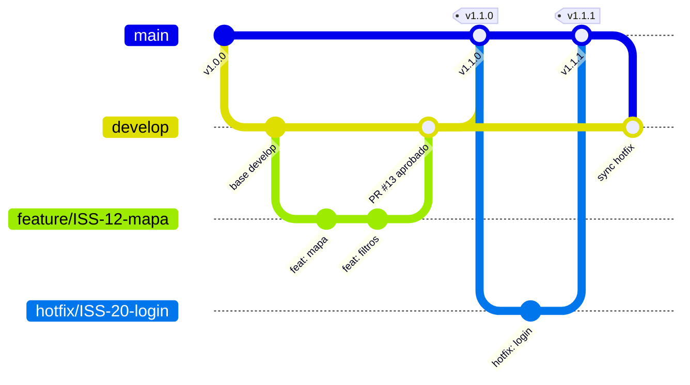
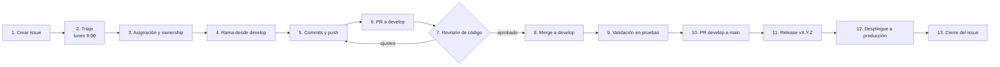

# Manual del Repositorio — Fábrica de Software procalculoFactory

> **Repositorio:** `procalculoFactory/Metodologia` · Reglas de la organización
> **Repositorio de Environments:** https://procalculo-my.sharepoint.com/my?id=%2Fpersonal%2Fjdiaz%5Fprocalculo%5Fcom%2FDocuments%2FEnvironments
> **Tablero de trabajo (GitHub Project):** https://github.com/orgs/procalculoFactory/projects/1
> **Última revisión:** octubre 2026 · **Responsable:** Líder Técnico (@procalculoFactoryLeader)

El presente manual constituye la referencia oficial de los procesos de la Fábrica de Software. Establece el procedimiento para la creación, revisión y despliegue de tareas, describe el funcionamiento de cada aplicación y documenta la resolución de las incidencias más frecuentes. Incluye, además, una guía dirigida a la gerencia y a los perfiles no técnicos que requieren supervisar el trabajo registrado en GitHub.

---

## Instructivo de lectura

| Perfil | Lectura principal | Lectura complementaria |
|---|---|---|
| **Gerencia / Product Owner** | [Parte A — Guía de GitHub para la gerencia](#parte-a--guía-de-github-para-la-gerencia) | [Parte B — Mapa de la organización](#parte-b--mapa-de-la-organización) |
| **Desarrollador de nuevo ingreso** | [Parte C — Ciclo de vida de una tarea](#parte-c--ciclo-de-vida-de-una-tarea-creación-revisión-y-despliegue) | [Parte D — Manual por aplicación](#parte-d--manual-por-aplicación) |
| **Líder técnico / revisor** | [C.4 Revisión de código](#c4-revisión-de-código-code-review) | [Parte E — Hallazgos y mejoras pendientes](#parte-e--hallazgos-y-mejoras-pendientes) |

## Tabla de contenido

- [Estructura del equipo](#estructura-del-equipo)
- [Parte A — Guía de GitHub para la gerencia](#parte-a--guía-de-github-para-la-gerencia)
  - [A.1 Conceptos fundamentales](#a1-conceptos-fundamentales)
  - [A.2 Consulta del historial de cambios (commits)](#a2-consulta-del-historial-de-cambios-commits)
  - [A.3 Modelo de ramas](#a3-modelo-de-ramas)
  - [A.4 Lectura de un Pull Request](#a4-lectura-de-un-pull-request)
  - [A.5 Seguimiento del trabajo en el Project](#a5-seguimiento-del-trabajo-en-el-project)
  - [A.6 Identificación de la versión en producción](#a6-identificación-de-la-versión-en-producción)
  - [A.7 Rutina semanal de seguimiento](#a7-rutina-semanal-de-seguimiento)
  - [A.8 Glosario](#a8-glosario)
- [Parte B — Mapa de la organización](#parte-b--mapa-de-la-organización)
- [Parte C — Ciclo de vida de una tarea: creación, revisión y despliegue](#parte-c--ciclo-de-vida-de-una-tarea-creación-revisión-y-despliegue)
- [Parte D — Manual por aplicación](#parte-d--manual-por-aplicación)
- [Parte E — Hallazgos y mejoras pendientes](#parte-e--hallazgos-y-mejoras-pendientes)
- [Bibliografía y referencias](#bibliografía-y-referencias)

---

## Estructura del equipo

| Rol | Persona | Usuario GitHub | Responsabilidades |
|---|---|---|---|
| **Líder técnico** | Sebastián Díaz | @procalculoFactoryLeader | Backend senior, Desktop, ArcGIS, arquitectura, supervisión general, triaje |
| **Fullstack 1** | Andrés Carlos | @andres-c94 | Frontend, backend de soporte, supervisión de Brayan |
| **Fullstack 2** | Brian Bohórquez | @bbohorquezs | Backend, frontend de soporte |
| **Cloud / Infraestructura / Developer Jr** | Brayan Gerez | @bgerez | Cloud, scripts de AWS |

---

# Parte A — Guía de GitHub para la gerencia

> **Objetivo:** proporcionar a cualquier integrante de la organización, sin formación en programación, los elementos necesarios para determinar en GitHub el trabajo realizado en el periodo, sus responsables, las tareas pendientes y la versión vigente en producción.

## A.1 Conceptos fundamentales

GitHub es la plataforma donde se almacena y controla el código fuente de las aplicaciones de la organización. Su funcionamiento es equiparable al de un gestor documental con control de versiones.

| Concepto | Equivalente funcional | Descripción |
|---|---|---|
| **Git** | Control de cambios de un procesador de texto, aplicado a un proyecto completo | Herramienta que registra cada modificación del código. GitHub es la plataforma web que aloja dicho registro ([GitHub Docs](https://docs.github.com/es/get-started/start-your-journey/about-github-and-git)). |
| **Organización** | La empresa dentro de GitHub | `procalculoFactory` agrupa los proyectos y los integrantes de la Fábrica. |
| **Repositorio** | Carpeta de proyecto con su historial completo | Cada aplicación cuenta con su propio repositorio, por ejemplo `mapasco-landing-web` o `prisma-agro-desktop` ([GitHub Docs](https://docs.github.com/es/repositories/creating-and-managing-repositories/about-repositories)). |
| **Commit** | Versión guardada del proyecto, con nota explicativa | Cada avance registrado deja constancia del autor, la fecha y el cambio realizado. |
| **Rama (branch)** | Copia de trabajo paralela | Permite desarrollar sin afectar la versión estable. Una vez aprobada, se integra a la versión principal ([GitHub Docs](https://docs.github.com/es/pull-requests/collaborating-with-pull-requests/proposing-changes-to-your-work-with-pull-requests/about-branches)). |
| **Issue** | Ticket o requerimiento | Registro de una solicitud, error o mejora, con responsable, prioridad y fechas ([GitHub Docs](https://docs.github.com/es/issues/tracking-your-work-with-issues/about-issues)). |
| **Pull Request (PR)** | Solicitud formal de aprobación | El desarrollador solicita la revisión de su trabajo antes de integrarlo a la versión principal ([GitHub Docs](https://docs.github.com/es/pull-requests/collaborating-with-pull-requests/proposing-changes-to-your-work-with-pull-requests/about-pull-requests)). |
| **Merge** | Aprobación e incorporación | Integración de los cambios aprobados en la rama destino. |
| **Project** | Tablero de gestión (Kanban) | Presenta las tareas por estado: pendiente, en curso, en revisión y finalizada ([GitHub Docs](https://docs.github.com/es/issues/planning-and-tracking-with-projects/learning-about-projects/about-projects)). |
| **GitHub Actions** | Automatización de procesos | Ejecuta pruebas y despliegues de forma automática ante cada cambio ([GitHub Docs](https://docs.github.com/es/actions/about-github-actions/understanding-github-actions)). |
| **GitHub Pages** | Servicio de publicación web | Publica sitios estáticos directamente desde un repositorio; lo utilizan varias páginas de la organización ([GitHub Docs](https://docs.github.com/es/pages/getting-started-with-github-pages/what-is-github-pages)). |
| **Release / Tag** | Versión oficial numerada | Identifica la versión exacta entregada, por ejemplo `v1.2.0` ([GitHub Docs](https://docs.github.com/es/repositories/releasing-projects-on-github/about-releases)). |

## A.2 Consulta del historial de cambios (commits)

**Procedimiento (no requiere instalación):**

1. Ingresar a https://github.com/procalculoFactory y seleccionar el repositorio.
2. Hacer clic en el indicador **"Commits"**, ubicado sobre la lista de archivos.
3. Se presenta la lista de commits en orden cronológico descendente. Cada registro contiene:
   - **Mensaje:** descripción del cambio (ej. `feat(ui): agregar sección de industrias`).
   - **Autor** y **fecha**.
   - **Identificador** corto (ej. `a1b2c3d`), único para cada cambio.
4. Al seleccionar un commit se visualiza el detalle de la modificación: las líneas en verde corresponden a adiciones y las líneas en rojo a eliminaciones.
5. Para consultar otra rama, utilizar el selector de ramas ubicado en la parte superior izquierda.

**Interpretación del mensaje.** La organización adopta la convención [Conventional Commits](https://www.conventionalcommits.org/es/v1.0.0/):

| Prefijo | Significado |
|---|---|
| `feat(...)` | Nueva funcionalidad |
| `fix(...)` | Corrección de un error |
| `hotfix(...)` | Corrección urgente en producción |
| `docs(...)` | Cambio exclusivo de documentación |
| `refactor(...)` | Mejora interna del código sin cambio funcional visible |
| `chore(...)` | Mantenimiento (configuración, dependencias) |

> **Indicador de control:** los commits con mensajes genéricos como *"Add files via upload"* o *"update"* evidencian una carga manual de archivos desde el navegador, por fuera del flujo de ramas y revisión. Se recomienda solicitar la justificación correspondiente.

Referencia: [Ver y comparar commits — GitHub Docs](https://docs.github.com/es/pull-requests/committing-changes-to-your-project/viewing-and-comparing-commits/differences-between-commit-views)

## A.3 Modelo de ramas

La organización adopta el modelo **GitFlow** ([Driessen, 2010](https://nvie.com/posts/a-successful-git-branching-model/); [Atlassian](https://www.atlassian.com/es/git/tutorials/comparing-workflows/gitflow-workflow)), estructurado de la siguiente manera:

| Rama | Función | Regla |
|---|---|---|
| `main` | Versión en producción | Contiene únicamente lo desplegado en producción. No se desarrolla directamente sobre ella. |
| `develop` | Integración | Consolida las funcionalidades terminadas antes de su paso a producción. |
| `feature/ISS-...` | Desarrollo de nuevas funcionalidades | Se crea desde `develop` y se integra en `develop`. |
| `bugfix/ISS-...` | Corrección de errores | Se crea desde `develop` y se integra en `develop`. |
| `hotfix/ISS-...` | Atención de incidentes en producción | Se crea desde `main` y se integra en `main` y en `develop`. |



**Consulta de ramas:** dentro del repositorio, abrir el selector de ramas y seleccionar **"View all branches"**. Se presentan las ramas activas, las desactualizadas y las que tienen un Pull Request asociado.

## A.4 Lectura de un Pull Request

1. Abrir la pestaña **"Pull requests"** del repositorio.
2. Cada PR presenta uno de los siguientes estados: **Open** (en revisión), **Merged** (aprobado e integrado) o **Closed** (descartado).
3. Secciones del PR:
   - **Conversation:** descripción, issue vinculado (`Fixes #123`) y observaciones de los revisores.
   - **Commits:** secuencia de cambios del desarrollador.
   - **Checks:** resultado de las pruebas automáticas (aprobadas o fallidas).
   - **Files changed:** archivos modificados.
4. Un PR se considera listo para integración cuando cuenta con al menos una aprobación (*Approved*), las verificaciones automáticas en estado exitoso y un issue vinculado.

Referencia: [Acerca de las revisiones de PR — GitHub Docs](https://docs.github.com/es/pull-requests/collaborating-with-pull-requests/reviewing-changes-in-pull-requests/about-pull-request-reviews)

## A.5 Seguimiento del trabajo en el Project

El tablero https://github.com/orgs/procalculoFactory/projects/1 consolida los issues de todos los repositorios. Cada tarea registra los siguientes campos:

| Campo | Valores en uso | Finalidad |
|---|---|---|
| **Type** | `Feature`, `Task`, `Bug` | Clasificación de la tarea |
| **Priority** | `Urgent`, `High`, `Medium`, `Low` | Orden de atención |
| **Effort** | `High`, `Medium`, `Low` | Estimación del esfuerzo |
| **Start date / Target date** | Fechas | Planificación de la entrega |
| **Assignees** | Responsable | Rendición de cuentas |

**Vistas recomendadas para la gerencia:**
- **Board:** columnas por estado. Las tareas con permanencia prolongada en *In Progress* requieren seguimiento.
- **Table:** filtros por responsable (`assignee:usuario`) o prioridad (`priority:Urgent`).
- **Roadmap:** línea de tiempo basada en *Start date* y *Target date*, útil para identificar retrasos.

## A.6 Identificación de la versión en producción

- **Principio general:** el contenido de la rama `main` corresponde a la versión en producción.
- La pestaña **"Releases"** lista las versiones oficiales con numeración [SemVer](https://semver.org/lang/es/) `MAYOR.MENOR.PARCHE`. La versión `2.3.1`, por ejemplo, corresponde a la versión mayor 2, con tres entregas de funcionalidad y una corrección.
- La pestaña **"Actions"** informa el resultado del último despliegue automatizado.
- En los sitios publicados con GitHub Pages, la sección **"Deployments"** (columna derecha del repositorio) indica la fecha del último despliegue.

## A.7 Rutina semanal de seguimiento

| Periodicidad | Control | Ubicación |
|---|---|---|
| **Lunes 9:00** | Triaje: issues nuevos con prioridad y responsable asignados | Project, vista Table, filtro `no:assignee` |
| **Miércoles** | Tareas con más de cinco días en *In Progress* | Project, vista Board |
| **Viernes** | Entregas de la semana: PRs integrados | `https://github.com/pulls?q=org:procalculoFactory+is:merged+merged:>AAAA-MM-DD` |
| **Cada entrega** | Existencia de un Release con notas de versión | Pestaña Releases de cada repositorio |

## A.8 Glosario

| Término | Definición |
|---|---|
| **Clone** | Descarga de una copia del repositorio a un equipo local |
| **Push** | Envío de commits locales a GitHub |
| **Pull** | Actualización del equipo local con los cambios de GitHub |
| **Conflicto** | Modificación simultánea de las mismas líneas por dos personas; requiere una decisión manual ([GitHub Docs](https://docs.github.com/es/pull-requests/collaborating-with-pull-requests/addressing-merge-conflicts/about-merge-conflicts)) |
| **Branch protection** | Regla que impide integrar cambios en `main` sin revisión ([GitHub Docs](https://docs.github.com/es/repositories/configuring-branches-and-merges-in-your-repository/managing-protected-branches/about-protected-branches)) |
| **CI/CD** | Integración y despliegue continuos: pruebas y despliegues automatizados |
| **Secret** | Contraseña o llave de API; no debe almacenarse en el código |
| **Label** | Etiqueta de clasificación de un issue o PR (`bug`, `enhancement`, etc.) |
| **Milestone** | Agrupación de issues correspondiente a una entrega o sprint |

---

# Parte B — Mapa de la organización

## B.1 Repositorios

| Repositorio | Descripción | Tecnología | Visibilidad | Despliegue | Responsable principal |
|---|---|---|---|---|---|
| [`Metodologia`](https://github.com/procalculoFactory/Metodologia) | Manual y reglas de la Fábrica | Markdown | Pública | GitHub Pages | @procalculoFactoryLeader |
| [`mapasco-landing-web`](https://github.com/procalculoFactory/mapasco-landing-web) | Landing page de Mapas CO | HTML, CSS, JS | Pública | GitHub Pages | @andres-c94 |
| [`landing-page-web-v2-mockup`](https://github.com/procalculoFactory/landing-page-web-v2-mockup) | Prototipo multipágina del nuevo sitio corporativo (soluciones, industrias, ArcGIS, soporte) | HTML, CSS, JS | Pública | GitHub Pages | @andres-c94 |
| [`team-progress`](https://github.com/procalculoFactory/team-progress) | Tablero de resultados de la Fábrica ("FABRICA 2025") | HTML | Pública | GitHub Pages | @procalculoFactoryLeader |
| [`prisma-agro-desktop`](https://github.com/procalculoFactory/prisma-agro-desktop) | Add-in de ArcGIS Pro para Prisma Agro (mosaico multidimensional NGRDI) | C#, .NET 8, WPF, ArcGIS Pro SDK | Pública | Archivo `.esriAddinX` | @bbohorquezs / @procalculoFactoryLeader |
| [`sh-ott`](https://github.com/procalculoFactory/sh-ott) | Herramientas Python de Sentinel Hub: áreas quemadas, deforestación y descarga de polígonos por índice | Python, sentinelhub-py, GeoPandas | Pública (ver E.2) | Ejecución local | Por definir |
| **ABACO** *(repositorio privado)* | Sistema de monitoreo de deforestación en producción | AWS | Privada | AWS (CloudFront) | Por completar |
| **Prisma API** *(repositorio privado)* | API de análisis de imágenes satelitales en producción | AWS | Privada | AWS | Por completar |
| **Mapas.co** *(repositorio privado)* | Plataforma web geoespacial | AWS | Privada | AWS | Por completar |

> **Nota:** la información de los repositorios privados se completará una vez verificado su contenido. Ver [E.1](#e1-información-pendiente).

## B.2 Asignación automática por tipo de tarea (estado objetivo)

```
Frontend Issues      -> @andres-c94
Backend Issues       -> @procalculoFactoryLeader
Desktop/ArcGIS       -> @procalculoFactoryLeader
Backend Fullstack    -> @andres-c94
Jr Frontend Tasks    -> @bgerez
Jr Backend Tasks     -> @bbohorquezs
Technical Review     -> @procalculoFactoryLeader
Cross-Project        -> @procalculoFactoryLeader
```

> **Estado actual:** ningún repositorio público dispone de la carpeta `.github/` con plantillas de issues; en consecuencia, la asignación automática no se encuentra activa. Ver [E.3](#e3-configuración-faltante-en-los-repositorios).

---

# Parte C — Ciclo de vida de una tarea: creación, revisión y despliegue



## C.1 Creación

**Partes autorizadas para crear issues:** clientes y usuarios (errores y solicitudes), Product Owner o gerencia, integrantes del equipo y QA.

**Procedimiento:**
1. Ingresar al **repositorio de la aplicación afectada** (no al Project) y seleccionar **Issues > New issue**.
2. Seleccionar el tipo: **Bug**, **Feature** o **Task**.
3. Redactar un **título breve y accionable**. Ejemplo adecuado: *"Error 500 al exportar polígonos en Mapas.co"*. Ejemplo inadecuado: *"no sirve"*.
4. Diligenciar la descripción con la plantilla correspondiente:

**Plantilla: Bug**
```markdown
## Comportamiento observado
## Comportamiento esperado
## Pasos para reproducir
1. ...
## Ambiente (producción / pruebas, navegador, versión)
## Evidencia (capturas, logs, URL)
```

**Plantilla: Feature / Task**
```markdown
## Objetivo
## Alcance
## Fuera de alcance
## Criterios de aceptación
- [ ] ...
## Entregables
## Referencias (diseños, documentos, SharePoint)
```

> **Referencia de buena práctica:** el issue `Metodologia#6 — PIP MVP` incluye objetivo, alcance, exclusiones, criterios de aceptación y entregables, y se adopta como modelo de redacción.

5. Asociar el issue al **Project #1** (panel derecho, sección *Projects*) y diligenciar **Priority**, **Effort** y fechas.

### C.1.1 Triaje semanal (lunes 9:00 a. m.), a cargo del líder técnico

1. Revisar los issues nuevos sin prioridad o con la etiqueta `needs-triage`.
2. **Asignar prioridad:**
   - **Urgent:** bloquea producción o usuarios.
   - **High:** afecta una funcionalidad relevante.
   - **Medium:** mejora significativa.
   - **Low:** mejora deseable.
3. **Estimar esfuerzo:**
   - **Low:** 1 a 2 días.
   - **Medium:** 3 a 5 días.
   - **High:** 1 semana o más.
   - **Épica:** debe dividirse en sub-issues.
4. Designar responsable y asignar al sprint vigente o al backlog.

## C.2 Desarrollo

### C.2.1 Asunción de la tarea
El responsable registra en el issue el siguiente comentario:
```
Tomando ownership de este issue
ETA: [fecha]
Preguntas: [si aplica]
```
A continuación, traslada la tarjeta a **In Progress** en el Project.

### C.2.2 Preparación de `develop` y creación de la rama

> **Regla:** las funcionalidades y correcciones no se crean desde `main`. Solo los hotfix se originan en `main`.

```bash
git fetch origin
git checkout develop
git pull origin develop
git merge origin/main        # garantiza que develop incluya los hotfix aplicados
git push origin develop

git checkout -b feature/ISS-123-descripcion-corta
git push -u origin feature/ISS-123-descripcion-corta
```

**Convención de nombres de ramas:**

| Tipo | Patrón | Origen | Destino |
|---|---|---|---|
| Funcionalidad | `feature/ISS-{n}-{descripcion}` | `develop` | `develop` |
| Corrección | `bugfix/ISS-{n}-{descripcion}` | `develop` | `develop` |
| Urgencia | `hotfix/ISS-{n}-{descripcion}` | `main` | `main` y `develop` |
| Tarea junior | `task/ISS-{n}-{descripcion}` | `develop` | `develop` |
| Refactorización | `refactor/ISS-{n}-{descripcion}` | `develop` | `develop` |

`{n}` corresponde al **número del issue en GitHub**. Ejemplo: `prisma-agro-desktop` utiliza `feature/ISS-1-ngrdi-refactoring` para el issue #1.

### C.2.3 Commits

```bash
git add <archivos>      # verificar previamente con "git status"
git commit -m "feat(ui): agregar sección de industrias

- Maquetar bloque de tarjetas
- Ajustar estilos responsive

Related to #6"
git push
```

| Tipo | Formato | Vínculo con el issue |
|---|---|---|
| Feature | `feat(scope): descripción` | `Related to #n` |
| Bugfix | `fix(scope): descripción` | `Fixes #n` (cierra el issue al integrar) |
| Hotfix | `hotfix(scope): descripción` | `Fixes #n` |

**Scopes de uso común:** `auth`, `ui`, `api`, `db`, `security`, `performance`, `gis`, `infra`, `docs`.

**Verificaciones previas a cada commit:**
- Con `git status`, confirmar que no se incluyen archivos `.env`, credenciales, `__pycache__/`, `bin/`, `obj/`, `node_modules/` ni resultados pesados (`.tif`, `.shp`).
- Confirmar que el `.gitignore` del repositorio contempla dichos casos.

## C.3 Apertura del Pull Request

1. Seleccionar **"Compare & pull request"** en GitHub. En su defecto, ir a *Pull requests > New* con **base:** `develop` y **compare:** `feature/ISS-...`.
2. **Título:** `feat(ui): Sección de industrias - ISS-6`
3. **Descripción** (plantilla `.github/pull_request_template.md`):

```markdown
## Descripción
## Issue relacionado
Fixes #___ / Related to #___
## Tipo de cambio
- [ ] Bug fix   - [ ] Feature   - [ ] Breaking change   - [ ] Docs
## Cambios realizados
## Procedimiento de prueba
## Evidencia (capturas / video)
## Lista de verificación
- [ ] Autorrevisión realizada
- [ ] Sin secretos ni archivos generados en el diff
- [ ] Pruebas o validación manual
- [ ] Documentación actualizada (README de la aplicación)
```

4. Configurar **Reviewers** (según la matriz de C.4), **Assignee**, **Labels** y **Project**.
5. Utilizar **Draft PR** cuando el trabajo no esté terminado.
6. Notificar en Teams: *"PR listo para revisión: [enlace]"*.

Referencia: [Vincular un PR a un issue — GitHub Docs](https://docs.github.com/es/issues/tracking-your-work-with-issues/using-issues/linking-a-pull-request-to-an-issue)

## C.4 Revisión de código (Code Review)

**Matriz de revisión**

| Autor del PR | Revisor obligatorio | Revisor opcional |
|---|---|---|
| @bgerez (Jr) | @andres-c94 | @procalculoFactoryLeader |
| @bbohorquezs | @procalculoFactoryLeader | @andres-c94 |
| @andres-c94 | @procalculoFactoryLeader | @bbohorquezs |
| @procalculoFactoryLeader | @andres-c94 o @bbohorquezs | — |
| Hotfix (cualquier autor) | @procalculoFactoryLeader | — |

**Lista de verificación del revisor**

| Área | Criterio |
|---|---|
| Lógica | Cumple lo solicitado en el issue y sus criterios de aceptación |
| Calidad | Estilo consistente, nomenclatura clara, sin código obsoleto |
| Pruebas | Pruebas aprobadas o validación manual documentada; cobertura de casos límite |
| Seguridad | Ausencia de credenciales en el código, validación de entradas, sin archivos `.env` en el diff |
| Rendimiento | Consultas y llamadas a APIs externas (Planet, Sentinel Hub, ArcGIS) con límites y paginación |
| GIS | CRS explícito, geometrías válidas, tratamiento de multipolígonos |
| Documentación | README de la aplicación actualizado cuando cambie la ejecución o el despliegue |

**Respuesta del revisor:** utilizar *Request changes* ante observaciones bloqueantes y *Comment* para sugerencias. La aprobación procede una vez resueltas todas las observaciones. El autor atiende cada comentario, actualiza la misma rama y solicita nueva revisión mediante **Re-request review**.

**Situaciones frecuentes:**

```bash
# Conflictos con develop
git checkout feature/ISS-123-x
git fetch origin && git merge origin/develop
# resolver los archivos señalados y continuar:
git add <archivos> && git commit -m "chore: resolver conflictos con develop"
git push

# Rama desactualizada (solo si la rama no es compartida)
git rebase origin/develop
git push --force-with-lease
```

Los PR de gran tamaño deben dividirse en entregas incrementales.

## C.5 Despliegue

### C.5.1 Flujo regular (release)

1. Integrar las funcionalidades aprobadas en `develop` y validarlas en el **ambiente de pruebas** de la aplicación (ver [Parte D](#parte-d--manual-por-aplicación)).
2. Abrir un PR de **`develop` hacia `main`** con el título `release: vX.Y.Z` y la relación de issues incluidos.
3. Tras la integración, crear el **tag y el Release**:
   ```bash
   git checkout main && git pull
   git tag -a v1.4.0 -m "Release 1.4.0"
   git push origin v1.4.0
   ```
   En GitHub, seleccionar **Releases > Draft a new release**, elegir el tag y utilizar **Generate release notes**.
4. Ejecutar el despliegue según el procedimiento de la aplicación (automatizado o manual, ver [Parte D](#parte-d--manual-por-aplicación)).
5. Realizar la verificación posterior al despliegue (*smoke test*) y cerrar los issues incluidos.

### C.5.2 Versionamiento (SemVer)

Acordado en `Metodologia#2` con base en [SemVer](https://semver.org/lang/es/):

| Componente | Criterio | Ejemplo |
|---|---|---|
| **MAYOR** | Cambio incompatible o rediseño | `1.4.2 -> 2.0.0` |
| **MENOR** | Nueva funcionalidad compatible | `1.4.2 -> 1.5.0` |
| **PARCHE** | Corrección de errores o hotfix | `1.4.2 -> 1.4.3` |

### C.5.3 Hotfix (incidente en producción)

```bash
git checkout main && git pull origin main
git checkout -b hotfix/ISS-789-descripcion
# corrección mínima y focalizada
git commit -m "hotfix(security): corregir validación de entrada

URGENT: Fixes #789"
git push -u origin hotfix/ISS-789-descripcion
```

1. Abrir un PR hacia **`main`** con el título `HOTFIX(scope): descripción - ISS-789`.
2. Asignar las etiquetas `hotfix` y `critical`. El revisor es el líder técnico, con un tiempo máximo de revisión de 30 minutos.
3. La descripción debe incluir el problema, la solución, las pruebas, el impacto (sistemas y usuarios) y el **plan de reversión**.
4. Integrar, crear el tag de **PARCHE** (`v1.4.3`), desplegar y aplicar monitoreo reforzado.
5. **Sincronizar `develop` de forma obligatoria:**
   ```bash
   git checkout develop && git pull
   git merge main
   git push origin develop
   ```

### C.5.4 Reglas de cumplimiento obligatorio

- Las funcionalidades y correcciones se integran en `develop`; los hotfix se integran en `main` y se sincronizan con `develop`.
- Todo PR debe estar vinculado a un issue (`Fixes #` / `Related to #`).
- No se permite el envío directo de cambios a `main` ni a `develop`.
- **Ningún secreto debe almacenarse en el repositorio.** Las credenciales se gestionan en GitHub Secrets, AWS Secrets Manager o el [Repositorio de Environments](https://procalculo-my.sharepoint.com/my?id=%2Fpersonal%2Fjdiaz%5Fprocalculo%5Fcom%2FDocuments%2FEnvironments).
- No se admite la carga manual de archivos ("Add files via upload") en repositorios de aplicaciones; todo cambio se tramita mediante rama y PR.

---

# Parte D — Manual por aplicación

Cada aplicación se rige por el ciclo descrito en la Parte C. Esta sección documenta los aspectos específicos de cada una: funcionalidad, ejecución, despliegue y resolución de incidencias frecuentes.

---

## D.1 `mapasco-landing-web` — Landing page de Mapas CO

**Descripción:** sitio estático de presentación comercial de Mapas CO. Archivos principales: `index.html`, `styles.css`, `main.js` y la carpeta `public/` (imágenes y recursos).

**URL publicada:** https://procalculofactory.github.io/mapasco-landing-web/

**Ejecución local:**
```bash
git clone https://github.com/procalculoFactory/mapasco-landing-web.git
cd mapasco-landing-web
python -m http.server 8080      # alternativa: npx serve .
# abrir http://localhost:8080
```

**Creación de tareas:** un issue por sección del sitio (patrón vigente: `Home-Section`, `solutions-section`, `industries-section`, `about-us-section`, `sac-sectione`). Cada issue debe incluir el enlace al insumo de mercadeo (SharePoint), los **criterios de aceptación** y las **capturas del diseño**. Actualmente los issues #4 a #8 contienen únicamente el enlace.

**Revisión:** validar en escritorio y dispositivos móviles (DevTools, modo responsive) y contrastar enlaces y textos con lo aprobado por mercadeo. Adjuntar capturas al PR.

**Despliegue:** GitHub Pages publica automáticamente la rama configurada en *Settings > Pages*. El archivo `.nojekyll` impide el procesamiento con Jekyll. Flujo: PR a `develop`, validación, PR de `develop` a `main` y publicación automática.

> **Observación:** el repositorio cuenta únicamente con la rama `main`. Se requiere crear `develop` antes de la siguiente tarea para dar cumplimiento a GitFlow.

**Incidencias frecuentes:**

| Síntoma | Causa probable | Solución |
|---|---|---|
| Los cambios no se reflejan tras la integración | Caché del navegador o de la CDN de Pages | Recarga forzada (Ctrl+Shift+R); revisar *Actions > pages-build-deployment* |
| Imágenes no visibles en Pages pero sí en local | Rutas absolutas (`/public/img.png`) en un sitio servido bajo `/mapasco-landing-web/` | Utilizar rutas relativas (`public/img.png`) |
| Archivos o carpetas con prefijo `_` devuelven 404 | Exclusión por parte de Jekyll | Conservar `.nojekyll` en la raíz |
| Error 404 en todo el sitio | Pages desactivado o rama mal configurada | *Settings > Pages*, origen: rama `main` / root |
| Falla del dominio propio | Ausencia del archivo `CNAME` o cambio en el DNS | Restaurar `CNAME`; verificar el registro DNS hacia `procalculofactory.github.io` |

---

## D.2 `landing-page-web-v2-mockup` — Prototipo del sitio corporativo v2

**Descripción:** prototipo navegable multipágina (`index.html`, `soluciones.html`, `soluciones-arcgis.html`, `industrias.html`, `quienes-somos.html`, `soporte.html`, `tratamiento-datos.html`) con `styles.css` y `script.js` compartidos.

**URL publicada:** https://procalculofactory.github.io/landing-page-web-v2-mockup/

**Ejecución, revisión y despliegue:** conforme a [D.1](#d1-mapasco-landing-web--landing-page-de-mapas-co). Por tratarse de un prototipo, los PR requieren, además de la aprobación técnica, la aprobación del área de negocio o mercadeo.

**Incidencias frecuentes:**

| Síntoma | Solución |
|---|---|
| El menú no navega entre páginas en Pages | Utilizar enlaces relativos (`soluciones.html`) en lugar de `/soluciones.html` |
| Estilos inconsistentes entre páginas | Importar el mismo `styles.css` en todas las páginas; evitar estilos en línea duplicados |
| `styles.css` de gran tamaño (~75 KB) y difícil mantenimiento | Segmentar por secciones o componentes al pasar a desarrollo productivo |
| Formularios de contacto sin envío | El prototipo no tiene backend; documentarlo en el issue o integrar un servicio de formularios en la versión productiva |

---

## D.3 `team-progress` — Tablero de resultados de la Fábrica

**Descripción:** tablero de una sola página (`index.html`) con los resultados del equipo ("FABRICA 2025"): métricas, puntajes de errores y elementos de gamificación.

**URL publicada:** https://procalculofactory.github.io/team-progress/

**Creación de tareas:** todo cambio en métricas o umbrales (por ejemplo, el puntaje de errores) debe contar con un issue que documente el **criterio de cálculo** acordado.

**Despliegue:** GitHub Pages desde `main`.

**Incidencias frecuentes:**

| Síntoma | Solución |
|---|---|
| Los datos no se actualizan | Los datos están embebidos en el HTML; se deben editar y desplegar. Se recomienda trasladarlos a un archivo `data.json` independiente |
| Errores de tildes o caracteres (ej. "ALINEACÓN") | Guardar el archivo en UTF-8 y verificar `<meta charset="utf-8">` |
| Exposición pública del rendimiento del equipo | Evaluar el cambio a repositorio privado (Pages en repositorios privados requiere plan de pago) |

---

## D.4 `prisma-agro-desktop` — Add-in de ArcGIS Pro (Prisma Agro)

**Descripción:** add-in para **ArcGIS Pro 3.5** desarrollado en C# (.NET 8, WPF) con el ArcGIS Pro SDK. Su desarrollo principal corresponde a la refactorización, bajo principios SOLID, de la herramienta de **mosaico multidimensional NGRDI** (issue #1). El README del repositorio contiene la **homologación arcpy / ArcGIS API for Python**, referencia para la migración de la lógica a servicios web.

**Estructura:** `Config.daml` (registro del add-in), `Module1.cs` (módulo principal), `Images/` y `DarkImages/` (íconos), `prisma-agro-desktop.csproj` y `.sln`.

**Ramas:** `main`, `develop` y `feature/ISS-1-ngrdi-refactoring`. Es el repositorio con mayor adherencia a GitFlow.

**Requisitos de compilación:**
- Windows con **ArcGIS Pro 3.5** instalado en `C:\Program Files\ArcGIS\Pro`.
- Visual Studio 2022 con la extensión **ArcGIS Pro SDK for .NET** y el SDK de .NET 8.

**Ejecución y depuración:** abrir el `.sln` en Visual Studio y ejecutar con F5. ArcGIS Pro inicia con el add-in cargado en la pestaña **Add-In**.

**Despliegue:** compilar en modo *Release* para generar `prisma-agro-desktop.esriAddinX` y publicarlo como **asset del Release** en GitHub (`vX.Y.Z`). La instalación se realiza mediante doble clic o desde *ArcGIS Pro > Settings > Add-In Manager*.

**Incidencias frecuentes:**

| Síntoma | Causa probable | Solución |
|---|---|---|
| Errores de referencia `ArcGIS.Desktop.*` al compilar | ArcGIS Pro instalado fuera de la ruta por defecto | Instalar en `C:\Program Files\ArcGIS\Pro` o ajustar las `HintPath` del `.csproj` |
| El add-in no aparece en ArcGIS Pro | Versión de Pro inferior a `desktopVersion` (3.5) definida en `Config.daml` | Actualizar ArcGIS Pro o reducir `desktopVersion` si el código lo permite |
| El add-in carga sin botones | El grupo `Group 1` de `Config.daml` no tiene controles registrados | Registrar los controles en `<controls>` y referenciarlos en el grupo |
| Autor mostrado como "Acme" / "macbookproretina" | Metadatos de plantilla en `Config.daml` | Actualizar `<Company>` a Procalculo S.A.S. y `<Author>` al equipo |
| Fallas en herramientas de imagen (NGRDI, anomalías) | Licencia Image Analyst / Spatial Analyst no disponible | Verificar las extensiones en *ArcGIS Pro > Licensing* |
| Diferencias de resultado entre ArcGIS Pro y la versión web | Funciones sin equivalencia directa (MajorityFilter, Fill) | Consultar la tabla de homologación del README del repositorio |

---

## D.5 `sh-ott` — Herramientas Sentinel Hub (quemas, deforestación, polígonos)

**Descripción:** tres módulos Python independientes que consultan **Sentinel Hub** (Sentinel-2), generan un ráster por índice y lo vectorizan:

| Módulo | Función | Entrada | Salida |
|---|---|---|---|
| `burn_zones/` | Detección de áreas quemadas mediante evalscript NBR y umbral | `data/aoi.geojson`, fechas, `burn_threshold` | `results/raster/*.tif`, `results/vector/*` (GeoJSON / shapefile) |
| `map_deforestation/` | Detección de deforestación entre dos fechas | AOI, fechas, `threshold` (por defecto 0.1) | TIFF en mosaico y shapefile de polígonos |
| `download_polygons/` | Descarga de un índice (NDVI por defecto) y vectorización por umbral | AOI, fechas, `index_name`, `threshold` | TIFF y vectores |

**Arquitectura** (común a los tres módulos): `run.py` > `factory.py` > `main_service.py`, que utiliza los servicios de `services/` (`sh_config`, `evalscript_gen`, `sh_client`, `raster_proc`, `*_vectorizer`). Las interfaces se definen en `interfaces.py` y los modelos de resultado en `models.py`.

**Ejecución:**
```bash
cd sh-ott/burn_zones            # o map_deforestation / download_polygons
python -m venv .venv && source .venv/bin/activate   # Windows: .venv\Scripts\activate
pip install sentinelhub geopandas rasterio python-dotenv numpy shapely
# crear un archivo .env LOCAL (no versionado) con SH_CLIENT_ID y SH_CLIENT_SECRET
python src/run.py
```

**Creación de tareas:** especificar el AOI (adjuntar el GeoJSON), el rango de fechas, el umbral y el resultado esperado.

**Revisión:** cargar el resultado en ArcGIS Pro o QGIS sobre una imagen de referencia y validar falsos positivos y falsos negativos.

**Despliegue:** herramienta de ejecución local. Su eventual paso a servicio requiere la integración con Prisma API o ABACO mediante un pipeline propio.

**Incidencias frecuentes:**

| Síntoma | Causa probable | Solución |
|---|---|---|
| `401 Unauthorized` o error de OAuth | Credenciales inválidas o rotadas | Revisar el `.env` local; generar un nuevo cliente OAuth en el panel de Sentinel Hub / Copernicus |
| `429 Too Many Requests` o cuota agotada | Límite de *processing units* | Reducir el AOI o la resolución; revisar la cuota de la cuenta |
| Resultado vacío o sin áreas detectadas | Rango de fechas sin imágenes despejadas | Ampliar el rango de fechas; aplicar máscara de nubes (SCL) en el evalscript |
| Procesamiento parcial del AOI | El código utiliza únicamente el primer feature y el primer anillo del GeoJSON | Unificar los polígonos antes de la ejecución o ajustar el código para iterar sobre todos los features |
| Análisis sobre un área mayor al AOI | Se utiliza el **bbox** del polígono y no su geometría | Recortar el resultado con el polígono (clip) antes de vectorizar |
| `ModuleNotFoundError: src` | Ejecución desde una carpeta incorrecta | Ejecutar desde la raíz del módulo o ajustar `PYTHONPATH` |
| Fechas fijas en el código | `run.py` define las fechas de forma estática | Recibirlas como argumentos de línea de comandos (`argparse`) |
| `burn_zones` elimina resultados anteriores | `main_service` limpia `results/raster` en cada ejecución | Utilizar una carpeta de salida por fecha o identificador de ejecución |

> **Alerta crítica:** este repositorio público contiene archivos `.env` versionados. Ver [E.2](#e2-seguridad-acciones-inmediatas).

---

## D.6 `Metodologia` — Manual de la Fábrica

**Descripción:** reglas de trabajo de la Fábrica, publicadas también en GitHub Pages: https://procalculofactory.github.io/Metodologia/

**Procedimiento de actualización del manual:** registrar un issue de tipo *Task* con la etiqueta `documentation` y abrir un PR desde `docs/ISS-n-...` hacia `main`, con aprobación del líder técnico.

> **Restricción:** al tratarse de un contenido público, no se deben incluir URLs internas sensibles, direcciones IP, nombres de buckets productivos ni credenciales.

**Issues de referencia:** #2 (versionamiento SemVer), #4 (guía de despliegue de frontend en S3 y CloudFront con OIDC) y #6 (MVP Planet Statistical API).

---

## D.7 Aplicaciones productivas en repositorios privados (ABACO, Prisma API, Mapas.co)

> **Nota:** esta sección se presenta como **plantilla**. El contenido de los repositorios privados está pendiente de verificación; su diligenciamiento corresponde al responsable de cada aplicación.

### Plantilla por aplicación

```markdown
### <Nombre de la aplicación>
- **Descripción y usuarios:**
- **Repositorios:** frontend: ___ · backend: ___ · infraestructura: ___
- **Stack:** (ej. Angular/React + Django REST Framework + PostGIS + ArcGIS Enterprise)
- **Ambientes:** desarrollo: ___ · pruebas: ___ · producción: ___
- **Ejecución local:** (docker compose up / pasos)
- **Variables de entorno:** Repositorio de Environments (nunca en el repositorio)
- **Despliegue:** (GitHub Actions > S3 + CloudFront / EKS / EC2)
- **Reversión:** (procedimiento para restaurar la versión anterior)
- **Monitoreo y logs:** (CloudWatch, etc.)
- **Incidencias frecuentes:** tabla síntoma / causa / solución
```

### Lineamientos de despliegue (AWS)

| Componente | Estándar de la Fábrica |
|---|---|
| **Frontend** (Angular / React / Vite) | Build > S3 privado con CloudFront y OAC > GitHub Actions con **OIDC** (sin access keys). Guía completa en `Metodologia#4`. Ver también [OIDC en AWS — GitHub Docs](https://docs.github.com/es/actions/security-for-github-actions/security-hardening-your-deployments/configuring-openid-connect-in-amazon-web-services) |
| **Backend** (DRF / FastAPI) | Imagen Docker > ECR > EKS o EC2. Las migraciones de base de datos se ejecutan como paso explícito del pipeline |
| **Secretos** | GitHub Secrets / AWS Secrets Manager; nunca en el código |

### Incidencias frecuentes transversales (AWS y GIS)

| Síntoma | Causa probable | Solución |
|---|---|---|
| El frontend presenta la versión anterior tras el despliegue | Caché de CloudFront | Invalidación `aws cloudfront create-invalidation --distribution-id <ID> --paths "/*"` en el pipeline |
| 403 *AccessDenied* al acceder al sitio | Bucket policy sin el ARN de la distribución (OAC) u objeto inexistente | Revisar la bucket policy; configurar `index.html` como *default root object* |
| Rutas internas de la SPA (ej. `/mapa`) devuelven 403 o 404 al recargar | CloudFront no redirige a `index.html` | *Custom error responses*: 403/404 > `/index.html` con código 200 |
| Certificado o dominio fuera de servicio | Registro CNAME de validación de ACM eliminado o DNS apuntando a una IP obsoleta | Restaurar el CNAME de validación; el DNS debe apuntar al dominio `*.cloudfront.net`, nunca a una IP |
| Error `Not authorized to perform sts:AssumeRoleWithWebIdentity` en el pipeline | El `sub` de la trust policy no coincide con el repositorio y la rama | Ajustar `repo:procalculoFactory/<repo>:ref:refs/heads/main` (sensible a mayúsculas) |
| Token de ArcGIS Enterprise vencido | Token de portal de corta duración | Renovar mediante OAuth2 / `GIS()` antes de cada lote; no persistir tokens |
| Capas vacías o desplazadas | Diferencia de CRS (4326, 3857, MAGNA-SIRGAS) | Reproyectar de forma explícita; validar con `ST_SRID` en PostGIS |

---

# Parte E — Hallazgos y mejoras pendientes

*Resultado de la revisión de los repositorios públicos de la organización (octubre de 2026).*

## E.1 Información pendiente

- [ ] El Project #1 y los repositorios privados no son accesibles para integraciones externas, dado que la organización tiene activas las **restricciones de acceso de OAuth Apps** ([GitHub Docs](https://docs.github.com/es/organizations/managing-oauth-access-to-your-organizations-data/about-oauth-app-access-restrictions)). La sección D.7 se completará una vez habilitado el acceso, o directamente por cada responsable.
- [ ] Documentar las columnas de estado (*Status*) y las vistas vigentes del Project #1.

## E.2 Seguridad: acciones inmediatas

| N.º | Hallazgo | Acción |
|---|---|---|
| 1 | El repositorio público `sh-ott` contiene `burn_zones/.env` y `download_polygons/.env` con credenciales OAuth de Sentinel Hub | **Rotar el client secret** de inmediato, eliminar los archivos `.env`, incorporar `.gitignore` y depurar el historial ([Eliminar datos sensibles — GitHub Docs](https://docs.github.com/es/authentication/keeping-your-account-and-data-secure/removing-sensitive-data-from-a-repository)). Evaluar el cambio a repositorio privado |
| 2 | Escaneo de secretos no habilitado | Activar **Secret scanning** y **Push protection** en la organización ([GitHub Docs](https://docs.github.com/es/code-security/secret-scanning/introduction/about-secret-scanning)) |
| 3 | Los seis repositorios visibles externamente son públicos, incluidos código de cliente y herramientas internas | Revisar la visibilidad de cada repositorio; el código de cliente y las herramientas internas deben ser privados |

## E.3 Configuración faltante en los repositorios

| Mejora | Estado actual | Acción |
|---|---|---|
| Carpeta `.github/` (plantillas de issue y PR) | Inexistente en los repositorios públicos | Crear un repositorio `.github` de organización con plantillas compartidas ([Plantillas de issues](https://docs.github.com/es/communities/using-templates-to-encourage-useful-issues-and-pull-requests/configuring-issue-templates-for-your-repository) · [Plantilla de PR](https://docs.github.com/es/communities/using-templates-to-encourage-useful-issues-and-pull-requests/creating-a-pull-request-template-for-your-repository)) |
| Etiquetas | Solo las nueve etiquetas predeterminadas de GitHub | Crear `needs-triage`, `in-progress`, `hotfix`, `critical`, `security`, `frontend`, `backend`, `desktop`, `infra` |
| Rama `develop` | Disponible solo en `prisma-agro-desktop` | Crearla en todos los repositorios de aplicaciones |
| Protección de ramas | Sin verificar | Proteger `main` y `develop`: PR obligatorio, una aprobación y verificaciones exitosas |
| GitHub Actions | Sin workflows en los repositorios públicos | Incorporar CI (lint y pruebas) y CD por aplicación |
| `.gitignore` | Ausente en `sh-ott` y `mapasco-landing-web` | Incorporar plantillas de Python, Visual Studio y Node |
| `README.md` por aplicación | Ausente en `sh-ott`, `mapasco-landing-web` y `landing-page-web-v2-mockup` | Trasladar la sección correspondiente de la Parte D |
| Dependencias Python | `sh-ott` sin `requirements.txt` | Generar `requirements.txt` o `pyproject.toml` por módulo |
| Archivos generados versionados | `__pycache__/` en `sh-ott` | Eliminarlos e incluirlos en `.gitignore` |
| Releases y tags | Sin uso | Aplicar SemVer (C.5.2) a partir de la siguiente entrega |

## E.4 Ajustes respecto a la versión anterior del documento

- La sección de creación de ramas indicaba partir de `main`, en contradicción con la regla de crear funcionalidades desde `develop`. Se unificó el criterio: **las funcionalidades y correcciones se originan en `develop`**.
- La numeración de pasos presentaba saltos (1 a 4); se reorganizó en la Parte C.
- Las plantillas de issue y la asignación automática se describían como activas sin estar configuradas; se registran como estado objetivo en B.2 y E.3.
- Los ejemplos en inglés se tradujeron y adaptaron a los repositorios reales.

---

# Bibliografía y referencias

### Git y GitHub (documentación oficial)
1. GitHub Docs. *Acerca de GitHub y Git.* https://docs.github.com/es/get-started/start-your-journey/about-github-and-git
2. GitHub Docs. *Acerca de Git.* https://docs.github.com/es/get-started/using-git/about-git
3. GitHub Docs. *Acerca de los repositorios.* https://docs.github.com/es/repositories/creating-and-managing-repositories/about-repositories
4. GitHub Docs. *Diferencias entre vistas de commits.* https://docs.github.com/es/pull-requests/committing-changes-to-your-project/viewing-and-comparing-commits/differences-between-commit-views
5. GitHub Docs. *Acerca de las ramas.* https://docs.github.com/es/pull-requests/collaborating-with-pull-requests/proposing-changes-to-your-work-with-pull-requests/about-branches
6. GitHub Docs. *Acerca de las solicitudes de incorporación de cambios.* https://docs.github.com/es/pull-requests/collaborating-with-pull-requests/proposing-changes-to-your-work-with-pull-requests/about-pull-requests
7. GitHub Docs. *Acerca de las revisiones de solicitudes de incorporación de cambios.* https://docs.github.com/es/pull-requests/collaborating-with-pull-requests/reviewing-changes-in-pull-requests/about-pull-request-reviews
8. GitHub Docs. *Acerca de los conflictos de fusión.* https://docs.github.com/es/pull-requests/collaborating-with-pull-requests/addressing-merge-conflicts/about-merge-conflicts
9. GitHub Docs. *Acerca de las incidencias.* https://docs.github.com/es/issues/tracking-your-work-with-issues/about-issues
10. GitHub Docs. *Vinculación de una solicitud de incorporación de cambios a una incidencia.* https://docs.github.com/es/issues/tracking-your-work-with-issues/using-issues/linking-a-pull-request-to-an-issue
11. GitHub Docs. *Acerca de Projects.* https://docs.github.com/es/issues/planning-and-tracking-with-projects/learning-about-projects/about-projects
12. GitHub Docs. *Configuración de plantillas de incidencias.* https://docs.github.com/es/communities/using-templates-to-encourage-useful-issues-and-pull-requests/configuring-issue-templates-for-your-repository
13. GitHub Docs. *Creación de una plantilla de solicitud de incorporación de cambios.* https://docs.github.com/es/communities/using-templates-to-encourage-useful-issues-and-pull-requests/creating-a-pull-request-template-for-your-repository
14. GitHub Docs. *Acerca de las ramas protegidas.* https://docs.github.com/es/repositories/configuring-branches-and-merges-in-your-repository/managing-protected-branches/about-protected-branches
15. GitHub Docs. *Acerca de los lanzamientos.* https://docs.github.com/es/repositories/releasing-projects-on-github/about-releases
16. GitHub Docs. *Entender GitHub Actions.* https://docs.github.com/es/actions/about-github-actions/understanding-github-actions
17. GitHub Docs. *Configuración de OpenID Connect en Amazon Web Services.* https://docs.github.com/es/actions/security-for-github-actions/security-hardening-your-deployments/configuring-openid-connect-in-amazon-web-services
18. GitHub Docs. *Introducción a GitHub Pages.* https://docs.github.com/es/pages/getting-started-with-github-pages/what-is-github-pages
19. GitHub Docs. *Eliminación de datos confidenciales de un repositorio.* https://docs.github.com/es/authentication/keeping-your-account-and-data-secure/removing-sensitive-data-from-a-repository
20. GitHub Docs. *Acerca del examen de secretos.* https://docs.github.com/es/code-security/secret-scanning/introduction/about-secret-scanning
21. GitHub Docs. *Acerca de las restricciones de acceso de OAuth App.* https://docs.github.com/es/organizations/managing-oauth-access-to-your-organizations-data/about-oauth-app-access-restrictions
22. GitHub Docs. *Creación de diagramas.* https://docs.github.com/es/get-started/writing-on-github/working-with-advanced-formatting/creating-diagrams
23. GitHub Skills. *Cursos interactivos.* https://skills.github.com/

### Libros y metodologías
24. Chacon, S. y Straub, B. *Pro Git* (2.ª ed., en español). Apress. https://git-scm.com/book/es/v2
25. Chacon, S. y Straub, B. *Ramificaciones en Git.* https://git-scm.com/book/es/v2/Ramificaciones-en-Git-%C2%BFQu%C3%A9-es-una-rama%3F
26. Driessen, V. (2010). *A successful Git branching model* (GitFlow). https://nvie.com/posts/a-successful-git-branching-model/
27. Atlassian. *Flujo de trabajo de Gitflow.* https://www.atlassian.com/es/git/tutorials/comparing-workflows/gitflow-workflow
28. *Conventional Commits 1.0.0.* https://www.conventionalcommits.org/es/v1.0.0/
29. Preston-Werner, T. *Versionado Semántico 2.0.0.* https://semver.org/lang/es/

### Tecnologías de las aplicaciones
30. Esri. *ArcGIS Pro SDK for .NET.* https://pro.arcgis.com/en/pro-app/latest/sdk/
31. Esri. *ArcGIS Pro SDK — Wiki y ejemplos.* https://github.com/Esri/arcgis-pro-sdk/wiki
32. Sinergise / Planet. *Sentinel Hub API documentation.* https://docs.sentinel-hub.com/api/latest/
33. *sentinelhub-py documentation.* https://sentinelhub-py.readthedocs.io/en/latest/
